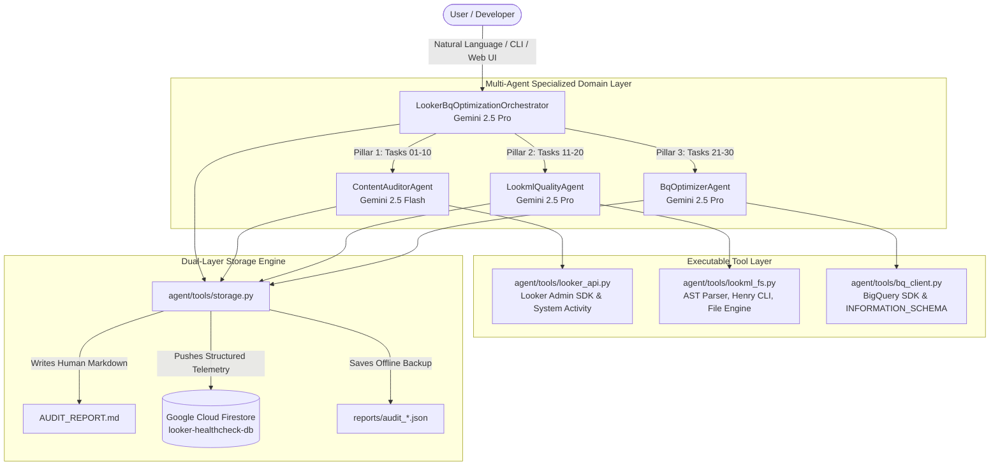

# Looker & BigQuery Optimization Agent: Complete Architecture & User Guide

> **A model-agnostic, multi-agent AI system built with Google Agent Development Kit (ADK), Gemini 2.5, Looker Admin APIs, Henry CLI, BigQuery INFORMATION_SCHEMA, and Google Cloud Firestore.**

---

## 📑 Table of Contents
1. [Executive Overview & Purpose](#1-executive-overview--purpose)
2. [High-Level Architecture & System Design](#2-high-level-architecture--system-design)
3. [Core Concept: Tools vs. Skills](#3-core-concept-tools-vs-skills)
4. [Comprehensive File-by-File Code Review](#4-comprehensive-file-by-file-code-review)
5. [The 30-Task Healthcheck Master Specification](#5-the-30-task-healthcheck-master-specification)
6. [Prerequisites & Step-by-Step Setup Guide](#6-prerequisites--step-by-step-setup-guide)
7. [User Interaction Guide (ADK Chat, Web UI, CLI)](#7-user-interaction-guide)
8. [End-to-End Gap Remediation Lifecycle](#8-end-to-end-gap-remediation-lifecycle)

---

## 1. Executive Overview & Purpose

The **Looker & BigQuery Optimization Agent** is an enterprise-grade pair-programming and instance optimization agent designed to systematically audit, identify, and remediate performance bottlenecks, modeling anti-patterns, and cost anomalies across any Looker deployment and underlying Google Cloud BigQuery data warehouse.

### Core Capabilities:
* **100% Generic & Model-Agnostic**: Dynamically discovers models, explores, views, and projects at runtime. Operates on any Looker instance without hardcoded assumptions.
* **Complete 30-Check Diagnostic Program**: Covers 3 comprehensive pillars:
  1. *Looker Instance & Content Health* (Subsystems, connections, dashboard tile density, auto-refresh limits, schedule spacing, query concurrency, unused content, unfiltered queries, merged queries, legacy features).
  2. *LookML & Modeling Quality* (Project syntax validation, primary key integrity, explicit join relationships, Henry unused field pruning, key exposure hygiene, folder architecture, naming conventions, metadata descriptions, unused joins, frontend table calculation bloat).
  3. *BigQuery & Compute Optimization* (Partition/cluster filters, BI Engine reservations, PDT build monitoring, incremental PDT keys, datagroup ETL synchronization, OAuth connection caching, Aggregate Awareness rollups, join key SQL hash syntax, snowflake schema denormalization, query costs and bytes billed).
* **Dual-Layer State Persistence**:
  * **Immediate Human Deliverable**: Automatically writes formatted, copy-pasteable Markdown scorecards and code remediation recipes directly to `AUDIT_REPORT.md`.
  * **Long-Term Time-Series Cloud Storage**: Automatically persists structured JSON audit telemetry to a dedicated Native Google Cloud Firestore database (`looker_healthchecks` collection) for historical trend tracking and CI/CD quality gates.

---

## 2. High-Level Architecture & System Design

The system is constructed using Google's **Agent Development Kit (ADK)** framework. It features a hierarchical multi-agent structure orchestrated by a master coordinator and three domain-specialized sub-agents.



---

## 3. Core Concept: Tools vs. Skills

To understand how the agent reasons and acts, it is essential to distinguish between **Tools** and **Skills**:

| Concept | What It Is | Purpose | Where Defined |
| :--- | :--- | :--- | :--- |
| **Tool** | **Executable Python Function** | Performs concrete operations: executes HTTP calls against Looker API, queries BigQuery, invokes Henry/looker-cli subprocesses, modifies `.lkml` files on disk, or writes to Firestore. | [`agent/tools/*.py`](file:///Users/sampitcher/Documents/Projects/looker-healthcheck-agent/agent/tools/) |
| **Skill** | **Domain Knowledge & Markdown Playbook** | Domain instructions, threshold benchmarks, diagnostic rules, and step-by-step remediation recipes injected into the LLM's prompt context to guide its reasoning. | [`agent/skills/*/skill.md`](file:///Users/sampitcher/Documents/Projects/looker-healthcheck-agent/agent/skills/) and [`skills/`](file:///Users/sampitcher/Documents/Projects/looker-healthcheck-agent/skills/) |

### Tool Breakdown:
1. **`agent/tools/looker_api.py`**:
   * Communicates with Looker 4.0 API and executes SQL queries against Looker's internal `system__activity` model (`history`, `dashboard`, `scheduled_plan`, `pdt_event_log`).
   * *Exported Tools*: `check_subsystem_status`, `audit_connections`, `get_tile_bloat_dashboards`, `get_auto_refresh_dashboards`, `get_schedule_distribution`, `get_concurrency_peaks`, `get_unused_content_and_folders`, `get_unfiltered_dashboards`, `get_merged_queries`, `get_legacy_features`, `get_table_calculation_heavy_queries`, `get_bi_engine_metrics`, `get_pdt_failure_audit`, `get_aggregate_awareness_hits`, `get_complex_join_explores`.
2. **`agent/tools/lookml_fs.py`**:
   * Scans local and remote LookML projects, parses view and explore blocks, checks primary keys, audits `relationship:` declarations, runs `henry vacuum` for dead field detection, enforces `fields: []` exposure, audits folder structure and snake_case casing, and applies automated AST patches.
   * *Exported Tools*: `run_lookml_validation`, `audit_primary_keys`, `audit_join_relationships`, `run_henry_vacuum`, `audit_explore_field_exposure`, `audit_folder_structure`, `audit_naming_conventions`, `audit_metadata_descriptions`, `audit_unused_joins`, `audit_incremental_pdts`, `audit_oauth_connections`, `audit_join_key_syntax`, `list_lookml_files`, `read_lookml_file`, `search_lookml_code`, `apply_lookml_patch`.
3. **`agent/tools/bq_client.py`**:
   * Connects to BigQuery via Google Cloud client library, queries `INFORMATION_SCHEMA.JOBS_BY_PROJECT` across regions, estimates query costs via dry runs, inspects table partitioning/clustering metadata, and audits slot reservation utilization.
   * *Exported Tools*: `audit_partition_cluster_filters`, `audit_datagroup_sync`, `audit_query_costs_and_bytes_billed`, `audit_bq_slots`, `list_dataset_tables`, `optimize_table_layout`, `estimate_query_cost_dry_run`.
4. **`agent/tools/storage.py`**:
   * Manages the dual-layer persistence engine.
   * *Exported Tools*:
     * `save_audit_report(report_markdown, structured_findings)`: Writes `AUDIT_REPORT.md` in root and persists to Firestore.
     * `get_audit_history(limit)`: Fetches past audit runs from Firestore or local `./reports/`.
     * `get_audit_document(audit_id)`: Retrieves a specific or latest complete audit document from Firestore.

---

## 4. Comprehensive File-by-File Code Review

```
looker-healthcheck-agent/
├── AUDIT_REPORT.md                                   # Root human-readable audit deliverable
├── ARCHITECTURE_AND_USER_GUIDE.md                    # Complete architecture, tools, and user guide
├── README.md                                         # Quickstart and project overview
├── requirements.txt                                  # Python dependencies
├── main.py                                           # Unified entrypoint (CLI audit & Web UI with Model Selector)
├── scripts/                                          # Utility and sync scripts
│   └── sync_skills.py                                # Automated syncer for upstream looker-open-source/looker-skills
├── agent/                                            # Core ADK Agent implementation
│   ├── __init__.py                                   # Agent package exports
│   ├── agent.py                                      # Master orchestrator & Sub-Agent graph
│   ├── skills_registry.py                            # Dynamic Looker skills indexer (28 playbooks)
│   ├── skills/                                       # Progressive agent skills
│   │   ├── content_audit/skill.md                    # Pillar 1 diagnostic instructions
│   │   ├── lookml_quality/skill.md                   # Pillar 2 diagnostic instructions
│   │   └── bq_optimizer/skill.md                     # Pillar 3 diagnostic instructions
│   └── tools/                                        # Executable Python tools
│       ├── __init__.py                               # Tool package exports
│       ├── looker_api.py                             # Looker API & System Activity tools (model-scoped)
│       ├── lookml_fs.py                              # LookML filesystem, safe patching, & Henry tools
│       ├── bq_client.py                              # BigQuery & INFORMATION_SCHEMA tools (model-scoped)
│       └── storage.py                                # Firestore & Markdown persistence engine (scoped schema)
├── looker_healthcheck_agent/                         # Mirror package for library distribution
├── skills/                                           # Extensive reference playbooks & recipes
│   ├── vendor/looker-skills/                         # Official upstream Google Cloud Looker engineering skills
│   ├── looker-healthcheck/                           # 8 Component offerings & diagnostic guides
│   │   ├── SKILL.md                                  # Top-level healthcheck methodology
│   │   ├── references/                               # Deep-dive diagnostic playbooks (01 to 08)
│   │   └── scripts/looker_healthcheck_runner.py      # Standalone diagnostic runner script
│   └── looker-refactoring-skill/                     # Refactoring, Henry, & migration guides
│       ├── SKILL.md                                  # Refactoring workflow
│       ├── references/                               # Henry guide, Spectacles CI, runtime recipes
│       └── scripts/                                  # Henry, looker-cli, and runtime migrator scripts
├── terraform/                                        # Infrastructure as Code for Firestore
│   ├── main.tf                                       # Provisions APIs, Firestore Native DB, Index
│   ├── variables.tf                                  # Configurable project, region, database ID
│   ├── outputs.tf                                    # Database ID & .env snippet
│   └── terraform.tfvars.example                      # Example configuration
└── reports/                                          # Local offline JSON audit backups
```

---

## 5. The 30-Task Healthcheck Master Specification

| No. | Pillar | Task / Check | Target Threshold | Action Performed by Agent |
| :---: | :--- | :--- | :--- | :--- |
| **01** | **Pillar 1** | Subsystem Status | HTTP 200 on `/alive` & `/availability` | Tests instance web server and database thread pools. |
| **02** | **Pillar 1** | Stale Connections | 0 inactive / broken connections | Audits `GET /api/4.0/connections` and validates host reachability. |
| **03** | **Pillar 1** | Dashboard Density | Max 25 tiles per dashboard | Scans `system__activity` for monolithic dashboards. |
| **04** | **Pillar 1** | Auto-Refresh Rate Limits | No auto-refresh < 30 minutes | Scans dashboard auto-refresh schedules to prevent thread exhaustion. |
| **05** | **Pillar 1** | Schedule Time Spacing | Staggered cron schedules (>=10m apart) | Identifies top-of-the-hour (`:00`) queue pileups. |
| **06** | **Pillar 1** | Query Concurrency Limits | Max 15 concurrent queries/node | Checks 24h query runtime peaks in `system__activity.history`. |
| **07** | **Pillar 1** | Unused Content Purge | 0 views in >90 days | Flags unqueried dashboards and looks for archiving. |
| **08** | **Pillar 1** | Frontend Filter Enforcement | All dashboards enforce filters | Detects unfiltered tiles causing full table scans. |
| **09** | **Pillar 1** | Merged Queries Evaluation | 0 in-memory merged queries | Identifies JVM memory-heavy merged results. |
| **10** | **Pillar 1** | Legacy Features Audit | 0 legacy flags enabled | Verifies deprecated features are disabled. |
| **11** | **Pillar 2** | LookML Project Validation | 0 compilation errors | Runs compilation via `looker-cli project validate`. |
| **12** | **Pillar 2** | Primary Key Enforcement | 100% of views have `primary_key: yes` | Enforces symmetric aggregate safety on joins. |
| **13** | **Pillar 2** | Explicit Join Relationships | 100% of joins declare `relationship:` | Prevents fan-out and inaccurate measure calculations. |
| **14** | **Pillar 2** | Henry Vacuum Unused Fields | 0 unused dimensions/measures | Scans 90-day field usage and flags dead fields for removal. |
| **15** | **Pillar 2** | Hide Technical / Raw Keys | `hidden: yes` on surrogate foreign keys | Enforces clean user exploration menus. |
| **16** | **Pillar 2** | Folder Hygiene | Dedicated `/views`, `/models`, `/explores` | Enforces modular LookML repository structure. |
| **17** | **Pillar 2** | Standard Casing | Standard `snake_case` on all fields | Eliminates casing collisions across explores. |
| **18** | **Pillar 2** | Metadata Descriptions | 100% of explores/measures documented | Enforces user-facing `description:` tags. |
| **19** | **Pillar 2** | Unused Joins Pruning | 0 unqueried joins (>90d) | Identifies bloated explores with unreferenced join paths. |
| **20** | **Pillar 2** | Table Calculation Bloat | 0 dashboards with heavy calculations | Flags tiles where math should be pushed to LookML measures. |
| **21** | **Pillar 3** | Partition / Cluster Filters | `conditionally_filter` on partition cols | Enforces mandatory partition pruning on large BigQuery tables. |
| **22** | **Pillar 3** | BI Engine Acceleration | >80% BI Engine reservation hits | Verifies sub-second BigQuery in-memory caching. |
| **23** | **Pillar 3** | PDT Build Failures | 0 failing PDT builds (past 7d) | Scans `pdt_event_log` for failed trigger executions. |
| **24** | **Pillar 3** | Incremental PDT Keys | `increment_key` on event tables | Prevents full table rebuilds on daily ETL runs. |
| **25** | **Pillar 3** | Datagroups Synced with ELT | `datagroup` triggers match pipeline | Eliminates polling queries and schedules builds with dbt/Airflow. |
| **26** | **Pillar 3** | OAuth Connection Caching | `persist_for` defined on connections | Prevents cache misses on user-attribute connections. |
| **27** | **Pillar 3** | Aggregate Awareness Hits | `aggregate_table` on top explores | Audits queries against candidate pre-aggregated tables. |
| **28** | **Pillar 3** | Join Key Hash Expressions | Join logic on base columns (no `CONCAT`) | Eliminates CPU-heavy string expressions in SQL `ON` clauses. |
| **29** | **Pillar 3** | Snowflake Denormalization | Explores capped at <=8 joins | Flags over-normalized join trees causing query plan degradation. |
| **30** | **Pillar 3** | Query Cost & Bytes Billed | Scan budget within threshold | Scans `INFORMATION_SCHEMA.JOBS_BY_PROJECT` for expensive queries. |

---

## 6. Prerequisites & Step-by-Step Setup Guide

### 1. System Requirements
* Python 3.10+ (macOS, Linux, or WSL2)
* Terraform 1.5+
* `gcloud` Google Cloud SDK authenticated

### 2. Install Python Dependencies
```bash
python3 -m venv .venv
source .venv/bin/activate
pip install -r requirements.txt
```

### 3. Provision Firestore Database with Terraform
Provision the dedicated Native Firestore database and composite time-series indexes:
```bash
cd terraform
terraform init
terraform apply -var="project_id=YOUR_GCP_PROJECT_ID"
cd ..
```

### 4. Configure Environment Variables (`.env`)
Create or edit `.env` in the repository root:
```env
# Google Cloud & Vertex AI Configuration
GOOGLE_GENAI_USE_VERTEXAI=true
GOOGLE_CLOUD_PROJECT=your-gcp-project-id
GOOGLE_CLOUD_LOCATION=us-central1

# Persistent Firestore Storage
FIRESTORE_DATABASE=looker-healthcheck-db
FIRESTORE_COLLECTION=looker_healthchecks

# Looker Instance Credentials (Admin or Develop role)
LOOKERSDK_BASE_URL=https://your-instance.looker.app
LOOKERSDK_CLIENT_ID=your_looker_client_id
LOOKERSDK_CLIENT_SECRET=your_looker_client_secret
LOOKER_PROJECT_ID=your_lookml_project_name
LOOKML_PROJECT_PATH=/path/to/your/local/lookml/repository

# Tooling Paths
LOOKER_CLI_PATH=~/.local/bin/looker-cli
```

---

## 7. User Interaction Guide

### Mode 1: Interactive Google ADK Chat (Recommended)

In the ADK Web chat or CLI agent session, you can converse naturally with the **Looker & BigQuery Optimization Orchestrator**:

#### Example Prompts:
* **Full Audit**:
  > *"Run a full 30-check healthcheck across the instance and LookML repo."*
  *(The agent executes all 30 checks, prints the scorecard matrix, provides remediation code, writes `AUDIT_REPORT.md`, and persists to Firestore).*
* **Targeted Domain Checks**:
  > *"Audit our LookML files for missing primary keys and unexplicit join relationships."*
  > *"Check our BigQuery query billing and unpartitioned table scans."*
  > *"Run Henry vacuum to find unused fields across our explores."*
* **Memory & Firestore Queries**:
  > *"Show me the latest Firestore audit document."*
  > *"Compare our current healthcheck with past audits to see what improved."*

---

### Mode 2: Interactive Web Dashboard (`python main.py --web`)

Launch the built-in healthcheck hub:
```bash
.venv/bin/python main.py --web
```
Open **`http://localhost:8080`** in your browser.

**Features:**
* **⚡ One-Click Full Audit**: Click *"Run Full 30-Check Audit"* to trigger live diagnostics across Looker and BigQuery.
* **☁️ Firestore Audit Archive**: The left sidebar lists all past audits from Firestore. Clicking any timestamped entry immediately loads its scorecard and details.
* **🏛️ Pillar-by-Pillar Drilldowns**: Inspect individual pillars (Instance, LookML, BigQuery) on demand.

---

### Mode 3: CLI Batch Execution & CI/CD Pipelines

To run a headless healthcheck in terminal or as part of a GitHub Actions / Cloud Build CI/CD quality gate:
```bash
.venv/bin/python main.py
```
* Generates [`AUDIT_REPORT.md`](file:///Users/sampitcher/Documents/Projects/looker-healthcheck-agent/AUDIT_REPORT.md).
* Persists telemetry to Firestore.
* Exits with code `0` on success or non-zero on failure.

---

## 8. End-to-End Gap Remediation Lifecycle

```
 ┌───────────────────────────────────────────────────────────┐
 │ 1. AUDIT & DISCOVER                                       │
 │ • Run 30-Task Healthcheck Program                         │
 │ • Identify CRITICAL and WARNING flags                     │
 └─────────────────────────────┬─────────────────────────────┘
                               │
                               ▼
 ┌───────────────────────────────────────────────────────────┐
 │ 2. REVIEW MASTER SCORECARD                                │
 │ • Review AUDIT_REPORT.md or Firestore Web Dashboard       │
 │ • Inspect pinpointed file paths and LookML views          │
 └─────────────────────────────┬─────────────────────────────┘
                               │
                               ▼
 ┌───────────────────────────────────────────────────────────┐
 │ 3. EXECUTE REMEDIATION RECIPES                            │
 │ • Add `primary_key: yes` to dimension keys                │
 │ • Declare explicit `relationship: many_to_one` on joins   │
 │ • Remove Henry-flagged unused fields                      │
 │ • Add `conditionally_filter` on BigQuery partitions       │
 │ • Apply patches via `apply_lookml_patch` tool             │
 └─────────────────────────────┬─────────────────────────────┘
                               │
                               ▼
 ┌───────────────────────────────────────────────────────────┐
 │ 4. RE-AUDIT & VERIFY                                      │
 │ • Re-run healthcheck to verify 100% PASSED score          │
 │ • Firestore records improvement trajectory over time      │
 └───────────────────────────────────────────────────────────┘
```

This ensures any Looker deployment remains high-performing, cost-efficient, and maintainable over its entire lifecycle.
