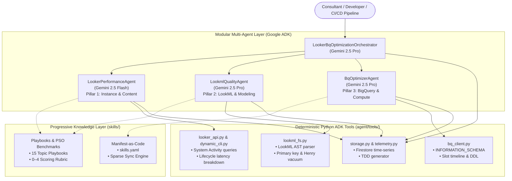

# Looker & BigQuery Healthcheck Agent: Architecture, Setup & Presentation Guide

> **Enterprise Multi-Agent System for Looker Instance Auditing, LookML Code Quality, and BigQuery Compute Optimization**
> *Built with Google Agent Development Kit (ADK), Gemini 2.5 Pro & Flash, Looker 4.0 APIs, and Google PSO Benchmarks.*

---

## 📑 Table of Contents
1. [Executive Summary & Value Proposition](#1-executive-summary--value-proposition)
2. [Multi-Agent Architecture & How It Works](#2-multi-agent-architecture--how-it-works)
3. [The 30-Check Diagnostic Matrix (3 Pillars)](#3-the-30-check-diagnostic-matrix-3-pillars)
4. [Core Architectural Design Principles](#4-core-architectural-design-principles)
5. [Prerequisites & Step-by-Step Setup Guide](#5-prerequisites--step-by-step-setup-guide)
6. [The 4 Execution Modes](#6-the-4-execution-modes)
7. [Presentation Flow & Live Demo Script](#7-presentation-flow--live-demo-script)
8. [Audience Q&A & Objection Handling](#8-audience-qa--objection-handling)
9. [Reference File Links](#9-reference-file-links)

---

## 1. Executive Summary & Value Proposition

### 🎙️ The 30-Second Elevator Pitch
> *"The Looker & BigQuery Healthcheck Agent is an autonomous, enterprise-grade AI assistant built with Google’s Agent Development Kit (ADK) and Gemini 2.5. It evaluates Looker instances across **3 Pillars and 30 diagnostic checks**—diagnosing query latency, LookML modeling hygiene, and BigQuery warehouse compute saturation against Google Cloud PSO (Professional Services Organization) benchmarks. Rather than giving generic recommendations, it runs live forensics, tracks health trajectory over time in Google Cloud Firestore, and generates a publication-grade remediation specification in `TECHNICAL_DESIGN_DOCUMENT.md` with exact LookML diffs and BigQuery DDL."*

### ⚠️ The Problem It Solves
1. **The Modern Data Stack Trilemma**: When a dashboard takes 60+ seconds to load, teams point fingers. LookML developers blame BigQuery, DBAs blame Looker's SQL generation, and BI analysts blame network latency. The bottleneck is actually a composite of **Looker JVM overhead, connection pool limits, symmetric aggregate fanouts, volatile datagroups, and unpruned table scans**.
2. **Context Window Dilution ("Context Rot")**: A monolithic AI agent analyzing an entire instance suffers from context rot, hallucinating schema parameters or dropping crucial checks.
3. **High Cost of Manual Audits**: Comprehensive Looker healthchecks typically take 2–4 weeks of senior consultant time. This agent completes deep-dive forensics in minutes.

---

## 2. Multi-Agent Architecture & How It Works

To eliminate context rot and enforce separation of concerns, the system is organized into a hierarchical multi-agent structure:



### Agent Roles & Model Tiers

| Agent Name | LLM Model | Core Responsibility |
| :--- | :--- | :--- |
| **`LookerBqOptimizationOrchestrator`** | `gemini-2.5-pro` | **Master Supervisor**: Ingests prompts, coordinates sub-agent transfers, manages model scoping (`thelook`), synthesizes ratings into scorecards, and compiles `TECHNICAL_DESIGN_DOCUMENT.md`. |
| **`LookerPerformanceAgent`** | `gemini-2.5-flash` | **Pillar 1 Specialist**: Dissects query lifecycles (`system__activity/query_metrics`), calculates Looker JVM overhead % vs DB execution vs connection wait, flags dashboard tile density (>25 tiles), auto-refresh abuse (<30m), and schedule stacking. |
| **`LookmlQualityAgent`** | `gemini-2.5-pro` | **Pillar 2 Specialist**: Parses LookML ASTs for missing `primary_key: yes` (preventing `SUM(DISTINCT ...)` symmetric aggregate hashing), enforces `relationship:` cardinality, identifies dead fields with Henry vacuum, and writes read-only code diffs. |
| **`BqOptimizerAgent`** | `gemini-2.5-pro` | **Pillar 3 Specialist**: Audits BigQuery `INFORMATION_SCHEMA` for slot contention curves, unpartitioned/unclustered scans, ETL datagroup sync mismatches, query billing outliers, and designs Aggregate Awareness rollups. |

---

## 3. The 30-Check Diagnostic Matrix (3 Pillars)

The agent systematically audits 30 distinct checks across the 3 pillars (10 checks per pillar):

```
                                 3-PILLAR HEALTHCHECK MATRIX
 ┌──────────────────────────────┬──────────────────────────────┬──────────────────────────────┐
 │    PILLAR 1: INSTANCE &      │      PILLAR 2: LOOKML &      │     PILLAR 3: BIGQUERY &     │
 │      CONTENT GOVERNANCE      │       MODELING QUALITY       │       COMPUTE ENGINE         │
 ├──────────────────────────────┼──────────────────────────────┼──────────────────────────────┤
 │ P1-01 Subsystem Health       │ P2-11 Syntax Validation      │ P3-21 Partition/Cluster Alignment│
 │ P1-02 Connection Pool Limits │ P2-12 Primary Key Integrity  │ P3-22 BI Engine Acceleration │
 │ P1-03 Dashboard Density (>25)│ P2-13 Explicit Relationships │ P3-23 PDT Build Failures     │
 │ P1-04 Auto-Refresh (<30m)    │ P2-14 Henry Dead Field Vacuum│ P3-24 Incremental PDTs       │
 │ P1-05 Schedule Staggering    │ P2-15 Raw Key Masking        │ P3-25 Datagroup ETL Sync     │
 │ P1-06 Query Concurrency Peaks│ P2-16 Folder & File Hygiene  │ P3-26 User Attribute Cache   │
 │ P1-07 Stale Content Purge    │ P2-17 snake_case Conventions │ P3-27 Aggregate Awareness    │
 │ P1-08 Explore Filter Enforce │ P2-18 User Descriptions      │ P3-28 SQL Join Functions     │
 │ P1-09 Merged Queries Audit   │ P2-19 Explore Join Bloat (>6)│ P3-29 Table Denormalization  │
 │ P1-10 Legacy Feature Deprec. │ P2-20 Table Calc Bloat       │ P3-30 Query Costs & Bytes    │
 └──────────────────────────────┴──────────────────────────────┴──────────────────────────────┘
```

---

## 4. Core Architectural Design Principles

### A. Open Knowledge Format (OKF v0.2) Knowledge Catalog Architecture
The knowledge subsystem strictly adheres to Google Cloud's [Open Knowledge Format (OKF v0.2)](https://github.com/GoogleCloudPlatform/knowledge-catalog/blob/main/okf/SPEC.md), standardizing how agentic systems share and consume curated domain intelligence:
* **Structured Concept Documents (§4)**: Every markdown playbook and reference document features a parseable YAML frontmatter header declaring non-empty `type:` (`Playbook`, `Reference`, `Skill`, `Attested Computation`, `Technical Design Document`), `status: stable`, and citation `sources: [...]`.
* **Dynamic Trust Tiers (§5.3)**: Automates multi-level provenance classification into `unverified`, `machine-confirmed`, and `human-reviewed` tiers.
* **Progressive Disclosure (`index.md`) (§8 & §12)**: Every directory level exposes structured table-of-contents listings, with bundle-root `skills/index.md` declaring `okf_version: "0.2"`.
* **Chronological Update Logs (`log.md`) (§9)**: Maintains timestamped update logs under `## YYYY-MM-DD` headings across all directory scopes.
* **Attested Computations (§10)**: Sanctioned telemetry queries, slot timelines, and BigQuery DDL templates are defined as verifiable computation contracts (`runtime: Looker` and `runtime: bigquery`) under `skills/custom/healthcheck/computations/`.

### B. Separation of Deterministic Tools vs. Progressive Knowledge
* **Deterministic Tools (`agent/tools/`)**: Pure Python functions with zero diagnostic assumptions. They execute REST API calls, query BigQuery, parse LookML ASTs, or write to Firestore.
* **Progressive Knowledge (`skills/`)**: Markdown playbooks containing Google PSO latency thresholds, query diagnostic flows, and scoring rubrics. Sub-agents load only the relevant playbook into prompt context via `get_skill_content("playbook_name")`.

### C. Manifest-as-Code Skill Ingestion (`skills.yaml`)
Upstream vendor skills (`looker-skills` open-source repository) are declared in `skills.yaml` and sparse-checked out on demand via `python3 scripts/sync_skills.py`:
* **Zero Submodule Friction**: No `.gitmodules` or detached-`HEAD` states.
* **Selective Ingestion**: Only curated directories are extracted onto disk, pruning sample dashboards and tutorial bloat.

### D. 5-Vector Forensic Triage Framework
Rather than simply telling developers to "add a date filter," the agent evaluates all 5 root-cause vectors:
1. **Lifecycle Latency Breakdown**: Deconstructs `system__activity/query_metrics` (DB execution vs connection wait vs Looker JVM overhead).
2. **SQL & Join Analysis**: Inspects compiled physical SQL via `get_query_sql(query_id)` for redundant joins or functions in `ON` clauses.
3. **Aggregate Awareness Acceleration**: For valid full-history metrics (e.g. lifetime user orders), prescribes `aggregate_table:` rollups rather than breaking business requirements.
4. **Warehouse Slot Contention**: Analyzes BigQuery slot timeline curves and stage shuffle spills via `INFORMATION_SCHEMA`.
5. **Concurrent Job Bursts**: Detects multi-tile dashboard pileups and top-of-hour (`:00`) schedule collisions.

### E. Read-Only Advisor Model
The agent operates as a **strictly read-only advisor** for your LookML repository. It does not overwrite files or push unverified commits. It outputs surgical before/after Markdown diffs with explicit rationale.

### F. Dual-Layer Persistence & OKF Deliverables
* **Structured Analytics**: Stores timestamped JSON audit records and scorecards directly into Google Cloud Firestore (`looker_healthchecks` collection) for longitudinal tracking.
* **Publication Deliverable**: Automatically synthesizes `TECHNICAL_DESIGN_DOCUMENT.md` adhering to OKF v0.2 with executive summaries, Mermaid architecture diagrams, before/after code blocks, and phased ROI tables.

---

## 5. Prerequisites & Step-by-Step Setup Guide

### 1. Prerequisites
* **Python 3.10+** (or [`uv`](https://github.com/astral-sh/uv) package manager)
* **Google Cloud SDK (`gcloud`)** authenticated with Vertex AI and BigQuery access
* **Looker Instance** (Admin API access or User account for OAuth)

---

### 2. Step-by-Step Installation

```bash
# 1. Clone the repository
git clone https://github.com/sam-pitcher/looker-healthcheck-agent.git
cd looker-healthcheck-agent

# 2. Set up virtual environment using uv (Recommended):
uv venv
source .venv/bin/activate
uv pip install -r requirements.txt

# Or using standard pip:
python3 -m venv .venv
source .venv/bin/activate
pip install -r requirements.txt
```

---

### 3. Sync Vendor Skills (Manifest-Driven)

Download curated Google Cloud Looker engineering playbooks into `skills/vendor/`:

```bash
python3 scripts/sync_skills.py
```

---

### 4. Configure Environment Variables (`.env`)

Copy the template configuration:
```bash
cp .env.example .env
```

Edit `.env` with your settings:
```ini
# Google Cloud Vertex AI & BigQuery
GOOGLE_GENAI_USE_VERTEXAI=true
GOOGLE_CLOUD_PROJECT=your-gcp-project-id
GOOGLE_CLOUD_LOCATION=us-central1
BIGQUERY_LOCATION=US
BIGQUERY_DATASET=the_look_ca

# Persistent Firestore Datastore
FIRESTORE_DATABASE=looker-healthcheck-db
FIRESTORE_COLLECTION=looker_healthchecks

# Looker Instance & Model Configuration (Zero local files required)
LOOKERSDK_BASE_URL=https://your-instance.looker.app
LOOKER_VERIFY_SSL=true
LOOKER_DEFAULT_MODEL=thelook
# LookML code is streamed live from the Looker instance via looker-cli over OAuth
```

---

### 5. Looker Authentication

Choose one of two authentication methods:

#### Option A: Zero-Secret Interactive User OAuth (Recommended for Developers)
Authenticate directly through your browser without managing static API keys:
```bash
# Run the interactive OAuth login helper:
python3 scripts/oauth_login.py

# Or authenticate using Looker CLI:
looker-cli profile add default --host "your-instance.looker.app" --port 443
looker-cli session login --oauth --client-id com.looker.cli
```
*The agent automatically inherits your user OAuth token from `~/.config/looker-cli/config.yaml` or `.env`.*

#### Option B: API3 Client Credentials (For Headless CI/CD)
Add your service account API credentials to `.env`:
```ini
LOOKERSDK_CLIENT_ID=your_api_client_id
LOOKERSDK_CLIENT_SECRET=your_api_client_secret
```

---

### 6. (Optional) Provision Firestore with Terraform

If you need to provision a dedicated Google Cloud Firestore database:
```bash
cd terraform
terraform init
terraform apply -var="project_id=your-gcp-project-id"
cd ..
```

---

## 6. The 4 Execution Modes

```
                                  ┌──────────────────────────────┐
                                  │   4 WAYS TO RUN THE AGENT    │
                                  └──────────────┬───────────────┘
                     ┌───────────────────────────┼───────────────────────────┐
                     ▼                           ▼                           ▼
            1. GOOGLE ADK WEB            2. HEALTHCHECK HUB          3. HEADLESS CI/CD
            `uv run adk web`             `python main.py --web`      `python main.py`
            (Chat at :8000)              (Dashboard at :8080)        (Automated Exit Code)
```

### Mode 1: Google ADK Web UI (Conversational Chat)
Launch the official Agent Development Kit chat interface:
```bash
uv run adk web
```
Open **`http://localhost:8000`** in your browser.
* **Example Prompts**:
  * *"Run a performance review on the 'thelook' model."*
  * *"Audit the top slow queries in the flights explore."*
  * *"Audit our LookML files for missing primary keys and unexplicit joins."*
  * *"Check BigQuery slot contention from the past 24 hours."*
  * *"Generate technical design document."*

### Mode 2: Interactive Healthcheck Hub (`python main.py --web`)
Launch the standalone healthcheck web UI:
```bash
python main.py --web
```
Open **`http://localhost:8080`** to:
* Trigger one-click 30-check benchmark audits across any discovered model.
* Browse historical audit archives stored in Firestore with visual scorecards.

### Mode 3: Headless CLI & CI/CD Pipelines
Execute automated audits directly from the command line:
```bash
# Run audit across all discovered models:
python main.py

# Run audit scoped to a specific model:
python main.py --model=thelook
```
* Generates `TECHNICAL_DESIGN_DOCUMENT.md`.
* Persists telemetry to Firestore.
* Exits with code `0` on success or non-zero on critical diagnostic failures (ideal for CI/CD gates).

### Mode 4: Programmatic Python API
Embed the orchestrator into your own Python applications:
```python
from agent.agent import root_agent

response = root_agent.run("Run a 3-pillar healthcheck audit on the 'thelook' model.")
print(response)
```

---

## 7. Presentation Flow & Live Demo Script

| Time | Stage | Action & Key Talking Points |
| :--- | :--- | :--- |
| **0:00 - 2:00** | **The Problem** | • Introduce the fragmentation of Looker/BigQuery performance investigations.<br/>• Highlight the finger-pointing dilemma: LookML vs BigQuery vs Looker JVM.<br/>• State the goal: Autonomous, standardized 30-check diagnostic audits based on Google Cloud PSO benchmarks. |
| **2:00 - 4:00** | **The Multi-Agent Architecture** | • Present the Mermaid Architecture Diagram.<br/>• Explain the 3 Pillars: Looker Performance, LookML Quality, BigQuery Compute.<br/>• Emphasize model selection: `gemini-2.5-flash` for high-throughput telemetry, `gemini-2.5-pro` for deep code AST and SQL reasoning.<br/>• Highlight Manifest-as-Code (`skills.yaml`) and zero Git submodule bloat. |
| **4:00 - 8:00** | **Live Demo (ADK Web UI)** | • Switch to browser at `http://localhost:8000`.<br/>• Prompt: *"Run a full 3-pillar healthcheck on the 'thelook' model."*<br/>• Point out the live agent transfers: Orchestrator ➡️ LookerPerformanceAgent ➡️ BqOptimizerAgent ➡️ LookmlQualityAgent.<br/>• Highlight live telemetry: `query_metrics` latency decomposition, slot curves, and AST primary key checks. |
| **8:00 - 10:00** | **The Deliverables** | • Show the live Executive Scorecard in the chat interface.<br/>• Open `TECHNICAL_DESIGN_DOCUMENT.md` to showcase the 7-section engineering spec, before/after LookML diffs, BigQuery DDL, and Mermaid target architecture.<br/>• Open `http://localhost:8080` to show Firestore historical audit persistence. |
| **10:00 - 12:00** | **Business Impact & ROI** | • Summarize projected ROI: **~85% query latency reduction**, **~95% slot capacity freed**, **~83% faster dashboard UX**.<br/>• Open the floor to Audience Q&A. |

---

## 8. Audience Q&A & Objection Handling

### Q1: Does the agent modify our production LookML code directly?
> **Answer**: No. The agent acts strictly as a **read-only advisor**. It parses the LookML AST and provides exact before/after Markdown diffs and DDL scripts for human review and validation.

### Q2: How does the agent handle sensitive data and credentials?
> **Answer**: The agent only queries Looker System Activity metadata and BigQuery `INFORMATION_SCHEMA` metadata—it never accesses or transfers row-level customer PII. Furthermore, it supports Zero-Secret PKCE OAuth, inheriting the user's active session without storing permanent API keys.

### Q3: Why use a Multi-Agent architecture with Google ADK instead of a single prompt?
> **Answer**: A complete 30-check healthcheck requires dozens of tool executions, AST parses, SQL queries, and reference to 15+ Google Cloud playbooks. Splitting the problem across specialized sub-agents completely eliminates context window dilution ("context rot") and allows pairing fast models (`gemini-2.5-flash`) for telemetry with deep models (`gemini-2.5-pro`) for code analysis.

### Q4: How is this updated when Looker or BigQuery releases new features?
> **Answer**: Through **Manifest-as-Code** (`skills.yaml`). New best-practice playbooks from Google Cloud and Looker Open Source can be ingested in seconds using `python3 scripts/sync_skills.py`, without touching agent core code or managing Git submodules.

---

## 9. Reference File Links

* 📖 Master Documentation: [README.md](README.md)
* 📑 Remediation Deliverable: [TECHNICAL_DESIGN_DOCUMENT.md](TECHNICAL_DESIGN_DOCUMENT.md)
* 🧠 Multi-Agent Runtime: [agent/agent.py](agent/agent.py)
* 📦 Skill Dependencies Manifest: [skills.yaml](skills.yaml)
* 🔧 Looker API & System Activity: [agent/tools/looker_api.py](agent/tools/looker_api.py)
* ⚡ BigQuery Engine & Slots: [agent/tools/bq_client.py](agent/tools/bq_client.py)
* 🔍 LookML AST & Code Hygiene: [agent/tools/lookml_fs.py](agent/tools/lookml_fs.py)
* 💾 Firestore & Report Storage: [agent/tools/storage.py](agent/tools/storage.py)
* 🎯 Performance Playbook: [skills/custom/healthcheck/playbooks/playbook_looker_performance.md](skills/custom/healthcheck/playbooks/playbook_looker_performance.md)
