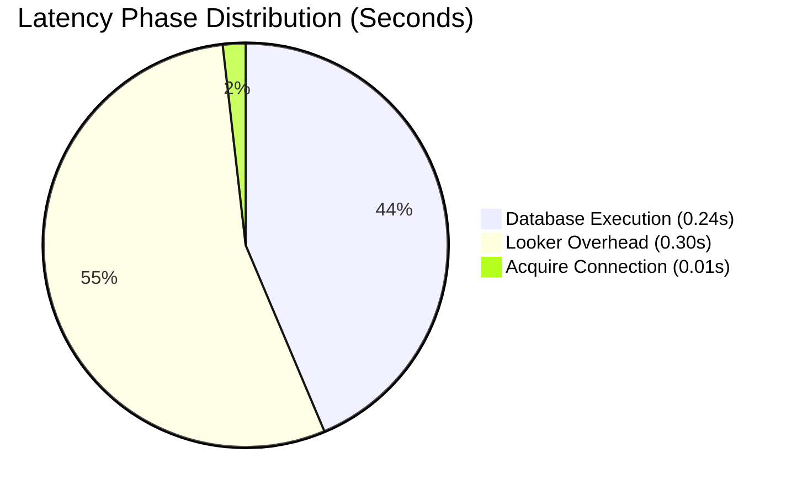

# Looker Instance Healthcheck & Performance Audit
**Instance:** `https://915eab0a-ce5e-423b-81fb-1e93c2f3424d.looker.app`  
**Audited At:** `2026-08-06 13:02:15 UTC`  
**Auditing Framework:** Google PSO Consolidated Healthcheck Benchmarks  

---

## 1. Executive Performance Scorecard

| Metric | Instance Current | PSO Benchmark | Status | Diagnostic Verdict |
| :--- | :---: | :---: | :---: | :--- |
| **Average Async Processing** | **`0.557s`** | `< 5.0s` | 🟢 Healthy | Within PSO Guidelines |
| **Main Query Execution** | **`0.240s`** | `< 4.87s` | 🟢 Healthy | Within PSO Guidelines |
| **Acquire Connection Time** | **`0.012s`** | `< 0.238s` | 🟢 Healthy | Within PSO Guidelines |
| **Model Init (Compute)** | **`0.000s`** | `< 2.42s` | 🟢 Healthy | Optimal |
| **Explore Init (Compute)** | **`0.000s`** | `< 0.233s` | 🟢 Healthy | Optimal |
| **Stream to Cache Time** | **`0.232s`** | `< 0.223s` | 🟡 Warning | Approaching Threshold |
| **Post-Processing Time** | **`0.003s`** | `< 0.223s` | 🟢 Healthy | Within PSO Guidelines |
| **Indicative Looker Overhead** | **`54.6%`** (`0.304s`) | `< 20.0%` | 🔴 Critical | Proportion of time spent inside Looker processing |

---

## 2. Query Latency Phase Distribution

## 3. Slowest Outlier Queries

| Query ID | User | Explore / View | Dashboard | Async Runtime | DB Execution |
| :--- | :--- | :--- | :--- | :---: | :---: |
| `771` | Super Admin | `interaction_logs` | Ad-hoc / Explore | `468.91s` | `0.00s` |
| `771` | Super Admin | `interaction_logs` | Ad-hoc / Explore | `56.50s` | `0.00s` |
| `904` | Super Admin | `interaction_logs` | Ad-hoc / Explore | `36.92s` | `1.05s` |
| `839` | Super Admin | `interaction_logs` | Ad-hoc / Explore | `31.84s` | `0.95s` |
| `921` | Super Admin | `interaction_logs` | Conversational Analytics Logging | `26.74s` | `0.97s` |

---

## 4. Prescribed Optimization Recipes

Execute the following master recipes from **`looker-healthcheck`** in your IDE:

### 🛠️ Recipe 4: Totals & Post-Processing Optimization
- Right-size row limits on single-value KPI cards and migrate table calculations to LookML measures.
