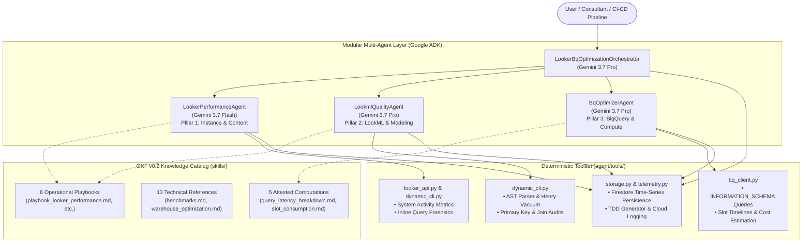
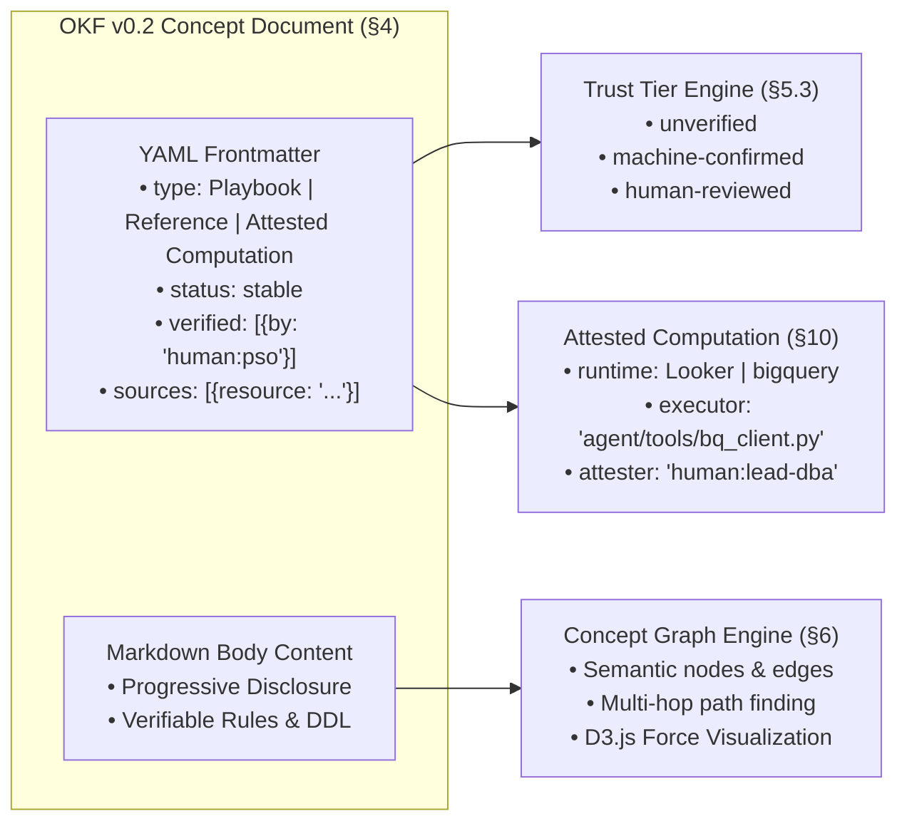

# Looker & BigQuery Optimization Multi-Agent System
## Technical Architecture Deep Dive & Presentation Deck Guide

> **An In-Depth Reference Guide for Slide Decks, Keynote Presentations, and Architectural Reviews**
> *Covering System Topology, The 30-Check Diagnostic Matrix, Open Knowledge Format (OKF v0.2), Skills vs. Tools, Hierarchical ADK vs. A2A Swarms, Target Personas, and Slide-by-Slide Speaker Talking Points.*

---

## 📑 Document Structure & Navigation

1. [Executive Summary & High-Level Narrative](#1-executive-summary--high-level-narrative)
2. [The "WHAT": System Overview & Core Capabilities](#2-the-what-system-overview--core-capabilities)
3. [The "WHY": Business Drivers & Technical Motivation](#3-the-why-business-drivers--technical-motivation)
4. [Architecture Rationale: Hierarchical ADK vs. Agent-to-Agent (A2A) Swarms](#4-architecture-rationale-hierarchical-adk-vs-agent-to-agent-a2a-swarms)
5. [Deep Dive: Skills & Playbooks Architecture](#5-deep-dive-skills--playbooks-architecture)
6. [Deep Dive: Open Knowledge Format (OKF v0.2) Standard](#6-deep-dive-open-knowledge-format-okf-v02-standard)
7. [The "HOW": End-to-End Execution & 5-Vector Forensic Triage](#7-the-how-end-to-end-execution--5-vector-forensic-triage)
8. [Target Personas & Value Matrix ("Who Can Use It?")](#8-target-personas--value-matrix-who-can-use-it)
9. [Slide-by-Slide Presentation Outline & Speaker Notes](#9-slide-by-slide-presentation-outline--speaker-notes)
10. [Objection Handling & Anticipated Audience Q&A](#10-objection-handling--anticipated-audience-qa)

---

## 1. Executive Summary & High-Level Narrative

### 🎙️ The Core Elevator Pitch
> *"When business dashboards take 60+ seconds to load, modern data teams face a trilemma: LookML developers blame BigQuery, DBAs blame Looker's SQL generation, and BI analysts blame network latency. The **Looker & BigQuery Healthcheck Agent** is an enterprise multi-agent system built on the **Google Agent Development Kit (ADK)** and **Gemini 3.7**. It runs an automated 30-check forensic audit across 3 pillars in under 2 minutes. Grounded in Google Cloud's **Open Knowledge Format (OKF v0.2)**, it dissects query lifecycles, parses LookML syntax trees, inspects BigQuery slot saturation, streams audit history to Firestore, and delivers a publication-grade technical specification with exact before/after code diffs and BigQuery DDL."*

### Key Architectural Differentiators at a Glance
* **Hierarchical ADK Multi-Agent Topology**: Eliminates LLM "context window rot" by decoupling orchestration from specialized domain inspection.
* **Strict Separation of Deterministic Tools vs. Progressive Skills**: Python execution tools contain zero hardcoded business logic; domain intelligence is dynamically loaded from OKF v0.2 Markdown playbooks.
* **Open Knowledge Format (OKF v0.2) Compliance**: Every rule, threshold, and query is an auditable, versioned concept document with dynamic Trust Tiers and Attested Computations.
* **5-Vector Query Forensic Framework**: Distinguishes between Looker JVM overhead, connection queueing, warehouse slot saturation, symmetric aggregate fanouts, and valid full-history metrics needing Aggregate Awareness.
* **Read-Only Code Advisory Model**: Safely inspects LookML ASTs and presents non-destructive, surgical code diffs.
* **Dual-Layer Persistence**: Real-time structured telemetry streamed to Google Cloud Firestore (`looker-healthcheck-db`) + automated generation of a 7-section [TECHNICAL_DESIGN_DOCUMENT.md](file:///Users/sampitcher/Documents/Projects/looker-healthcheck-agent/TECHNICAL_DESIGN_DOCUMENT.md).

---

## 2. The "WHAT": System Overview & Core Capabilities



### The 3-Pillar 30-Check Diagnostic Framework

The agent evaluates instances across an exhaustive matrix of 30 distinct checks:

```
┌──────────────────────────────────┬──────────────────────────────────┬──────────────────────────────────┐
│   PILLAR 1: INSTANCE & CONTENT   │     PILLAR 2: LOOKML QUALITY     │    PILLAR 3: BIGQUERY & COMPUTE  │
├──────────────────────────────────┼──────────────────────────────────┼──────────────────────────────────┤
│ P1-01 Subsystem Health & API     │ P2-11 Syntax & Compile Health    │ P3-21 Partition & Cluster Filter │
│ P1-02 Connection Pool Limits     │ P2-12 Primary Key Integrity      │ P3-22 BI Engine Acceleration     │
│ P1-03 Dashboard Tile Density (>25)│ P2-13 Explicit Join Cardinality  │ P3-23 PDT Build Failure Logs     │
│ P1-04 Auto-Refresh Rates (<30m)  │ P2-14 Henry Dead Field Vacuum    │ P3-24 Incremental PDT Strategy   │
│ P1-05 Schedule Time Staggering   │ P2-15 Raw Key & Column Masking   │ P3-25 Datagroup ETL Sync Trigger │
│ P1-06 Query Concurrency Peaks    │ P2-16 Folder & File Hygiene      │ P3-26 User Attribute Cache Scope │
│ P1-07 Stale Content Deprecation  │ P2-17 snake_case Conventions     │ P3-27 Aggregate Awareness Rollups│
│ P1-08 Explore Filter Enforcement │ P2-18 User-Facing Descriptions   │ P3-28 SQL Join Function Overhead │
│ P1-09 Merged Queries in Prod     │ P2-19 Explore Join Bloat (>6)    │ P3-29 Table Denormalization      │
│ P1-10 Legacy Feature Deprecation │ P2-20 Table Calculation Bloat    │ P3-30 BigQuery Costs & Bytes     │
└──────────────────────────────────┴──────────────────────────────────┴──────────────────────────────────┘
```

### The 4 Execution Modes
1. **Interactive Agent Chat (`uv run adk web`)**: Port `:8000` multi-turn chat powered by Google ADK.
2. **Interactive Healthcheck Hub (`python main.py --web`)**: Port `:8080` full dashboard featuring a live D3.js Force-Directed OKF Concept Graph and historical Firestore browser.
3. **Headless CLI & CI/CD Pipeline (`python main.py [--model=...]`)**: Automated execution producing pass/fail exit codes for automated build pipelines.
4. **Programmatic Python API (`from agent.agent import root_agent`)**: Embedding the multi-agent system directly into custom data platform pipelines.

---

## 3. The "WHY": Business Drivers & Technical Motivation

### 1. The Modern Data Stack Latency Trilemma
In traditional organizations, diagnosing slow Looker reports takes weeks due to organizational and architectural silos:
* **The Looker Developer** looks only at LookML models and assumes BigQuery is slow.
* **The BigQuery DBA** sees massive queries scanning terabytes and blames Looker's automated SQL generator.
* **The Business Stakeholder** sees a spinner for 45 seconds and assumes the network is congested.

**The Reality**: Slow performance is almost always an interaction effect:
* A missing `primary_key: yes` forces Looker to generate complex `SUM(DISTINCT ...)` symmetric aggregate subqueries.
* A datagroup using `SELECT GENERATE_UUID()` invalidates the cache on every query, flooding BigQuery.
* A dashboard with 38 tiles triggers 38 concurrent queries at 09:00 AM, exceeding Looker connection pool limits and queueing queries in Looker JVM before they ever reach BigQuery.

### 2. The Failure of Monolithic "Single-Agent" LLMs (Context Window Rot)
When a single, monolithic LLM is given 50+ tool definitions, LookML files, BigQuery schemas, and 500 lines of diagnostic rules:
* **Attention Degradation**: The agent suffers from "context rot," dropping diagnostic steps (e.g., forgetting to check datagroups or primary keys).
* **Hallucinated Parameters**: Monolithic agents frequently hallucinate LookML syntax or query filters.
* **Cost & Latency Explosion**: Every turn sends massive prompt contexts back and forth.

### 3. The Traditional Consulting Bottleneck
* A manual Looker healthcheck conducted by external consultants typically requires **2 to 4 weeks** of interviews, manual System Activity query building, spreadsheet scoring, and manual report writing.
* **The Agent Solution**: Completes the exact same 30-check Google PSO diagnostic protocol in **under 120 seconds**, outputting structured Firestore telemetry and a publication-grade TDD.

---

## 4. Architecture Rationale: Hierarchical ADK vs. Agent-to-Agent (A2A) Swarms

A critical design choice in this architecture is the use of a **Hierarchical Supervisor-Worker Topology (Google ADK)** rather than a **Decentralized Agent-to-Agent (A2A) Swarm / Peer-to-Peer Mesh**.

```
    HIERARCHICAL SUPERVISOR (Our Setup)                 DECENTRALIZED A2A SWARM (Alternative)
  ┌─────────────────────────────────────┐              ┌───────────┐       ┌───────────┐
  │   LookerBqOptimizationOrchestrator  │              │  Agent A  │ <───> │  Agent B  │
  └──────────────────┬──────────────────┘              └─────▲─────┘       └─────▲─────┘
         ┌───────────┼───────────┐                           │         ╳         │      
         ▼           ▼           ▼                           ▼        ╱ ╲        ▼      
   ┌───────────┐┌───────────┐┌───────────┐             ┌───────────┐ ╱   ╲ ┌───────────┐
   │ PerfAgent ││LookMLAgent││  BQAgent  │             │  Agent C  │ <───> │  Agent D  │
   └───────────┘└───────────┘└───────────┘             └───────────┘       └───────────┘
   • Deterministic delegation pipeline                 • Non-deterministic broadcast messaging
   • Zero risk of endless agent ping-pong              • High risk of infinite conversation loops
   • Single authority for document synthesis           • Fragmented state & multi-agent drift
   • Bounded context & cost-controlled                 • Token cost explosion
```

### Detailed Architecture Comparison

| Architectural Dimension | Hierarchical ADK Topology (This System) | Decentralized A2A Swarm / Mesh |
| :--- | :--- | :--- |
| **Execution Determinism** | **High & Predictable**: Master orchestrator sequences sub-agents according to strict diagnostic dependencies (Pillar 1 -> Pillar 3 -> Pillar 2). | **Low**: Agents broadcast messages dynamically, leading to unpredictable execution order and race conditions. |
| **Context Window Isolation** | **Strict Boundary**: Each sub-agent maintains its own scoped toolset and prompt context. Findings are streamed out immediately to Firestore to prevent memory bloat. | **Shared / Diffuse**: Context is replicated across peer messages, rapidly diluting attention and causing hallucinations. |
| **Loop & Ping-Pong Prevention** | **Guaranteed Termination**: Sub-agents return results to the supervisor. Sub-agents cannot trigger uncontrolled circular execution. | **High Loop Risk**: Agent A asks Agent B for data, Agent B asks Agent C, Agent C asks Agent A, leading to infinite token-draining loops. |
| **State Synthesis & Persistence** | **Centralized Synthesis**: The Orchestrator collects structured findings from all 3 pillars, calculates composite scores, and compiles [TECHNICAL_DESIGN_DOCUMENT.md](file:///Users/sampitcher/Documents/Projects/looker-healthcheck-agent/TECHNICAL_DESIGN_DOCUMENT.md). | **Fragmented**: No single agent owns the canonical truth; requires complex consensus protocols (voting/Raft-style LLM agreements). |
| **Tool & Security Governance** | **Least Privilege Tool Binding**: `LookmlQualityAgent` gets filesystem tools; `BqOptimizerAgent` gets BigQuery SQL tools; `LookerPerformanceAgent` gets Looker API tools. | **Broad Tool Access**: Every peer agent typically needs broad tool permissions, increasing the blast radius of LLM mistakes. |
| **Observability & Tracing** | **Unified ADK Lifecycle Callbacks**: Handled natively by [telemetry.py](file:///Users/sampitcher/Documents/Projects/looker-healthcheck-agent/agent/telemetry.py) (`CloudLoggingPlugin`) streaming spans directly to Google Cloud Logging. | **Distributed Tracing Nightmare**: Hard to correlate asynchronous message buses and multi-peer chatter into a coherent timeline. |

### Summary Rationale
For enterprise diagnostic tasks requiring rigorous standards compliance (Google PSO benchmarks, OKF v0.2), **deterministic hierarchical orchestration is strictly superior to decentralized swarms**. It ensures 100% check completion, bounded token costs, zero looping, and a single cohesive deliverable.

---

## 5. Deep Dive: Skills & Playbooks Architecture

### The Core Principle: Tools vs. Skills Separation

A foundational architectural law of this system is the strict separation between **Deterministic Python Tools** and **Progressive Knowledge Playbooks**:

```
 ┌────────────────────────────────────────────────────────┐
 │            DETERMINISTIC TOOLS (agent/tools/)          │
 │  • Pure Python functions (e.g. bq_client.py)           │
 │  • ZERO diagnostic rules, ZERO threshold assumptions   │
 │  • Job: Execute API call, query BigQuery, return JSON  │
 └───────────────────────────┬────────────────────────────┘
                             │ Returns raw execution data
                             ▼
 ┌────────────────────────────────────────────────────────┐
 │             LLM REASONING & PROMPT INGESTION           │
 └───────────────────────────▲────────────────────────────┘
                             │ Ingests domain rules on-demand
 ┌───────────────────────────┴────────────────────────────┐
 │           PROGRESSIVE SKILLS (skills/ & OKF v0.2)      │
 │  • Pure Markdown knowledge playbooks                   │
 │  • ZERO executable code                                │
 │  • Contains: Latency SLAs, 0–4 Rubrics, SQL recipes    │
 └────────────────────────────────────────────────────────┘
```

#### Why Separate Tools and Skills?
1. **Tool Agnosticism**: If Google changes Looker API 4.0 or BigQuery `INFORMATION_SCHEMA`, you update only a 10-line Python tool in `agent/tools/`. The 50-page diagnostic playbooks remain 100% untouched.
2. **Knowledge Evolution**: If your team tightens its dashboard tile limit from 25 to 15, or updates latency SLAs from 10s to 5s, you edit a Markdown playbook in `skills/`. You never recompile or deploy application code.
3. **Context Efficiency**: Instead of stuffing 20 playbooks into the LLM system prompt, sub-agents load only the relevant playbook dynamically at runtime via `get_skill_content("playbook_looker_performance.md")`.

### Manifest-as-Code Skill Ingestion (`skills.yaml`)

External vendor skills (from the official Google Cloud / Looker open-source ecosystem) are tracked declaratively via [skills.yaml](file:///Users/sampitcher/Documents/Projects/looker-healthcheck-agent/skills.yaml) and synced on demand:

```yaml
# skills.yaml snippet
vendor_skills:
  - repository: "https://github.com/looker-open-source/looker-skills"
    branch: "main"
    sparse_paths:
      - "skills/lookml-modeling-guidelines"
      - "skills/lookml-pdt-guidelines"
      - "skills/lookml-diagnostics"
```

* **Zero Submodule Friction**: No `.gitmodules`, detached `HEAD` states, or merge conflicts.
* **Selective Sparse Sync**: `python3 scripts/sync_skills.py` extracts only the 10 curated markdown playbooks onto disk, completely pruning sample dashboards, media assets, and tutorial tutorials.
* **Build-Time Dependency**: `skills/vendor/` is gitignored and treated as an immutable build-time dependency directory.

---

## 6. Deep Dive: Open Knowledge Format (OKF v0.2) Standard

The knowledge architecture complies 100% with the [Open Knowledge Format (OKF v0.2)](https://github.com/GoogleCloudPlatform/knowledge-catalog/blob/main/okf/SPEC.md), an open specification created by Google Cloud to standardize how AI agents share, verify, and traverse enterprise knowledge.



### Key OKF v0.2 Primitives in this Codebase:

#### 1. Structured Concept Documents (§4)
Every single markdown file in `skills/` contains standardized YAML frontmatter declaring non-empty `type:`, `status:`, and `sources:`.
```yaml
---
name: playbook_looker_performance
type: Playbook
status: stable
title: "Looker 4-Step Performance & Query Lifecycle Playbook"
description: "Tactical diagnostic flow for deconstructing query latency..."
tags: [performance, latency, system-activity, concurrency]
verified:
  - by: "human:google-pso-architect"
    date: "2026-08-20"
sources:
  - resource: "skills/custom/healthcheck/references/benchmarks.md"
    title: "Google PSO Benchmarks"
---
```

#### 2. Dynamic Trust Tiers (§5.3)
The [skills_registry.py](file:///Users/sampitcher/Documents/Projects/looker-healthcheck-agent/agent/skills_registry.py#L126-L160) engine calculates real-time trust classification:
* **`unverified`**: Concept has no cryptographic verifier or review entry.
* **`machine-confirmed`**: Validated by deterministic test suites or static AST parsers.
* **`human-reviewed`**: Verified and signed by a designated human authority (`human:lead-dba` or `human:google-pso-architect`).

#### 3. Attested Computations (§10)
Sanctioned telemetry queries and BigQuery DDL templates are encapsulated as executable contracts in `skills/custom/healthcheck/computations/`:
* Declares `runtime: Looker` (System Activity) or `runtime: bigquery` (SQL DDL).
* Specifies typed input `parameters:` and binds to an authorized Python `executor:`.
* Eliminates arbitrary LLM SQL generation for critical forensic queries.

#### 4. Progressive Disclosure (`index.md`) & Chronological Update Logs (`log.md`)
* Every directory level maintains an `index.md` (§8) table of contents (with bundle-root `skills/index.md` declaring `okf_version: "0.2"`).
* Every directory maintains a `log.md` (§9) tracking ISO-8601 `## YYYY-MM-DD` revision histories.

#### 5. Directed Concept Graph & D3.js Explorer (§6)
* [skills_registry.py](file:///Users/sampitcher/Documents/Projects/looker-healthcheck-agent/agent/skills_registry.py#L677-L793) builds an in-memory directed graph linking concepts, sources, tools, and computations.
* Accessible visually in the **Interactive Healthcheck Hub** (`python main.py --web`) via D3.js, allowing developers and agents to trace semantic hops during forensic investigations.

---

## 7. The "HOW": End-to-End Execution & 5-Vector Forensic Triage

### End-to-End Execution Flow (The 4-Stage Lifecycle)

```
 ┌──────────────────────────────────────────────────────────────────────────┐
 │ STAGE 1: INGESTION & AUTONOMOUS DISCOVERY                                │
 │ • User provides zero-config or open prompt: "Audit thelook model"       │
 │ • Orchestrator infers target models, projects, and BigQuery datasets     │
 └────────────────────────────────────┬─────────────────────────────────────┘
                                      │ Transfers control
                                      ▼
 ┌──────────────────────────────────────────────────────────────────────────┐
 │ STAGE 2: 3-PILLAR DEEP-DIVE TRIAGE (Real-Time Firestore Streaming)      │
 │ • Phase 1 (LookerPerformanceAgent): System Activity latency, tiles, crons│
 │ • Phase 2 (BqOptimizerAgent): BigQuery slots, partition DDL, query costs │
 │ • Phase 3 (LookmlQualityAgent): Primary keys, fanout joins, Henry vacuum │
 │ • Sub-agents call record_audit_finding(...) continuously to Firestore    │
 └────────────────────────────────────┬─────────────────────────────────────┘
                                      │ Returns findings
                                      ▼
 ┌──────────────────────────────────────────────────────────────────────────┐
 │ STAGE 3: TRANSCRIBER 0-4 SCORING & COMPOSITE EVALUATION                  │
 │ • Evaluates 4 dimensions: Architecture, Performance, Modeling, Governance│
 │ • Applies Google PSO Transcriber Rubric (0.0 Anti-Pattern -> 4.0 Excep.) │
 └────────────────────────────────────┬─────────────────────────────────────┘
                                      │ Final synthesis
                                      ▼
 ┌──────────────────────────────────────────────────────────────────────────┐
 │ STAGE 4: DUAL-LAYER PERSISTENCE & DELIVERABLE PUBLICATION                │
 │ • Layer 1: Saves structured JSON document to Firestore                   │
 │ • Layer 2: Compiles 7-section TECHNICAL_DESIGN_DOCUMENT.md with DDL/diffs│
 │ • Outputs concise 30-line Executive Summary in chat with document links  │
 └──────────────────────────────────────────────────────────────────────────┘
```

### The 5-Vector Forensic Query Triage Framework

When the agent identifies slow queries, it never gives generic advice like *"add a date filter"*. It systematically evaluates all 5 root-cause vectors:

```
                          5-VECTOR FORENSIC QUERY TRIAGE
                                        │
           ┌────────────────────────────┼────────────────────────────┐
           ▼                            ▼                            ▼
  Vector 1: Latency Phase     Vector 2: Physical SQL        Vector 3: Aggregate
         Breakdown               & Join Analysis                  Awareness
  • Looker JVM Overhead %     • get_query_sql(query_id)     • Is this a legitimate
  • Connection queue wait     • Catches SUM(DISTINCT ...)     unfiltered metric?
  • BigQuery execute time       fanout hashing overhead     • Prescribe aggregate_table
                                • Flags REGEXP_CONTAINS       rollups instead of filters
           ┌────────────────────────────┴────────────────────────────┐
           ▼                                                         ▼
  Vector 4: Warehouse Slot Contention               Vector 5: Concurrency Bursts
  • INFORMATION_SCHEMA.JOBS_BY_PROJECT              • Multi-tile dashboard pileups
  • Detects slot starvation (>200 slots)            • Top-of-hour (:00) schedule stacking
  • Identifies stage shuffle memory spills          • Overlapping datagroup triggers
```

---

## 8. Target Personas & Value Matrix ("Who Can Use It?")

| Persona | Core Pain Point | How They Use the Agent | Tangible Value / Outcome |
| :--- | :--- | :--- | :--- |
| **Looker / LookML Developers** | Symmetric aggregate fanouts, broken compile syntax, dead field bloat. | Runs agent in CLI or ADK Web UI on feature branches: `python main.py --model=my_model`. | Instant primary key validation, dead field pruning with Henry, copy-paste LookML code diffs. |
| **BI Platform Admins / Architects** | Exploding instance concurrency, 40-tile dashboards, schedule pileups crashing connections. | Runs weekly scheduled healthchecks; inspects Firestore trend scorecards. | Pinpoints auto-refresh abuse (<30m), detects zombie scheduled plans, enforces folder governance. |
| **BigQuery Engineers & DBAs** | Runaway slot usage, unpartitioned queries scanning terabytes, ETL sync mismatches. | Reviews Section 6 of `TECHNICAL_DESIGN_DOCUMENT.md` and BQ slot timeline outputs. | Exact DDL for partitioning/clustering, BI Engine memory sizing, eliminates functions in `sql_on:`. |
| **FinOps & Cloud Cost Leaders** | Unpredictable BigQuery on-demand scan bills and capacity spikes. | Audits `P3-30` query costs and `bytes_billed_by_model` Attested Computation. | Identifies top 5 most expensive explores; projects 30-50% dollar cost savings. |
| **Data & Cloud Consultants (PSO / SI)** | Spending 2–4 weeks conducting manual client instance healthchecks. | Runs the agent during client onboarding to generate instant diagnostic baselines. | Compiles a 7-section publication-grade architecture specification in 120 seconds. |
| **DevOps & CI/CD Platform Teams** | Bad LookML merged into production causing production downtime. | Embeds `python main.py` as a required pre-merge GitHub Action / Cloud Build step. | Non-zero exit codes block PRs with critical anti-patterns (missing PKs, fanout joins). |

---

## 9. Slide-by-Slide Presentation Outline & Speaker Notes

Use the following 10-slide blueprint to deliver an impactful 20-to-30 minute presentation or executive briefing:

---

### 🪟 Slide 1: Title & Vision
* **Slide Title**: Autonomous Looker & BigQuery Optimization: The Enterprise Multi-Agent System
* **Visual Elements**: Split screen: Chaos on the left (Slow dashboard, alert badges) vs. Structured Multi-Agent Hierarchy on the right.
* **Key Bullet Points**:
  * Built on Google Agent Development Kit (ADK) and Gemini 3.7 Pro/Flash.
  * 30-Check Diagnostic Matrix across Instance, LookML, and BigQuery.
  * 100% Compliant with Google Cloud Open Knowledge Format (OKF v0.2).
  * Automated generation of publication-grade Technical Design Documents.
* **🎙️ Speaker Notes**:
  > *"Good morning/afternoon everyone. Today, I'm excited to present our Looker & BigQuery Healthcheck Agent. In enterprise data stacks, diagnosing why a dashboard is slow typically takes weeks of finger-pointing between BI developers, DBAs, and platform admins. We built an autonomous multi-agent system that completes an exhaustive 30-check forensic healthcheck in under 2 minutes. It doesn't just give vague tips—it inspects live APIs, parses LookML code, analyzes BigQuery slot saturation, and writes exact code diffs and DDL specifications."*

---

### 🪟 Slide 2: The Modern BI Trilemma & The Problem
* **Slide Title**: The 60-Second Dashboard: Why Modern BI Audits Fail
* **Visual Elements**: 3-Way Trilemma Diagram (BI Developer ↔ BigQuery DBA ↔ Business Analyst) with bottleneck icons.
* **Key Bullet Points**:
  * **The Trilemma**: Blame game across LookML modeling, SQL generation, and warehouse compute.
  * **Hidden Culprits**: Missing primary keys forcing `SUM(DISTINCT)` hashing, volatile datagroup UUIDs, dashboard tile pileups.
  * **The Consulting Bottleneck**: 2 to 4 weeks of manual consulting time for an instance review.
  * **The LLM Trap**: Monolithic single-agent LLMs suffer from "context rot" and hallucinate parameters.
* **🎙️ Speaker Notes**:
  > *"Why is this problem so hard? Because dashboard latency is rarely caused by a single issue. It's an interaction effect. If a LookML developer forgets a primary key, Looker generates symmetric aggregates. That forces BigQuery to hash rows. If a dashboard has 35 tiles, 35 queries hit the connection pool simultaneously at 9:00 AM. A human consultant takes 3 weeks to trace these multi-layer dependencies. A single monolithic AI agent gets overwhelmed by context rot. We needed a specialized multi-agent architecture."*

---

### 🪟 Slide 3: Multi-Agent Architecture (Hierarchical ADK)
* **Slide Title**: Multi-Agent Topology: Separation of Concerns
* **Visual Elements**: Architecture diagram showing Orchestrator delegating to `LookerPerformanceAgent`, `LookmlQualityAgent`, and `BqOptimizerAgent`.
* **Key Bullet Points**:
  * **Master Orchestrator (`gemini-3.7-flash`)**: Zero-config model scoping, sub-agent sequencing, final synthesis.
  * **Pillar 1 (`gemini-3.7-flash`)**: Query lifecycle phase breakdown, tile density, schedule staggering.
  * **Pillar 2 (`gemini-3.7-flash`)**: LookML AST parser, primary keys, join relationships, Henry dead field pruning.
  * **Pillar 3 (`gemini-3.7-flash`)**: BigQuery `INFORMATION_SCHEMA` slot curves, partition DDL, datagroup ETL sync.
* **🎙️ Speaker Notes**:
  > *"Here is how our system works. We use the Google Agent Development Kit to orchestrate a hierarchy of specialized agents. Notice the model tiers: Pillar 1 uses Gemini 3.7 Flash for high-speed API telemetry ingestion. Pillars 2 and 3 use Gemini 3.7 Pro for deep AST parsing, complex SQL join analysis, and BigQuery optimization. Each sub-agent owns its domain tools, preventing context window dilution and ensuring deep forensic accuracy."*

---

### 🪟 Slide 4: Architectural Choice: Hierarchical ADK vs. A2A Swarms
* **Slide Title**: Why Hierarchical ADK Beats Decentralized A2A Swarms
* **Visual Elements**: Side-by-side comparison table (Predictable Hierarchical Pipeline vs. Chaotic Mesh Swarm).
* **Key Bullet Points**:
  * **Determinism & Sequencing**: Strict diagnostic dependency execution (Pillar 1 -> Pillar 3 -> Pillar 2).
  * **Zero Looping**: Eliminates endless agent-to-agent ping-pong conversations.
  * **Context Isolation**: Findings stream directly to Firestore; context is not duplicated across peer agents.
  * **Centralized Synthesis**: Single supervisor responsible for compiling the 7-section TDD specification.
  * **Least-Privilege Security**: Scoped tool bindings per agent.
* **🎙️ Speaker Notes**:
  > *"A key architectural decision was choosing Google ADK's hierarchical supervisor pattern over a decentralized Agent-to-Agent swarm. In enterprise audits, non-deterministic swarms are dangerous: agents can enter infinite communication loops, state gets fragmented, and token costs explode. Our hierarchical model ensures strict execution order, least-privilege tool security, bounded token usage, and a single authoritative compiler for final deliverables."*

---

### 🪟 Slide 5: Separation of Deterministic Tools vs. Progressive Skills
* **Slide Title**: The Architectural Law: Pure Tools vs. Pure Knowledge
* **Visual Elements**: Two-box diagram showing Python ADK Tools (`agent/tools/`) on the left and Markdown Playbooks (`skills/`) on the right.
* **Key Bullet Points**:
  * **Deterministic Tools**: Pure Python functions with zero hardcoded business logic (API calls, BigQuery queries, AST parsing).
  * **Progressive Skills**: Tool-agnostic Markdown playbooks containing Google PSO thresholds, scoring rubrics, and diagnostic recipes.
  * **Dynamic Ingestion**: Loaded into LLM prompt context just-in-time via `get_skill_content(...)`.
  * **Manifest-as-Code (`skills.yaml`)**: Sparse-syncs curated upstream vendor skills without git submodule bloat.
* **🎙️ Speaker Notes**:
  > *"One of our cleanest design patterns is the strict separation of Tools versus Skills. Our Python tools in `agent/tools/` have zero diagnostic assumptions—they just execute API calls and return data. All intelligence—the PSO latency thresholds, the 0-to-4 scoring rubrics, the remediation recipes—lives in pure Markdown playbooks in `skills/`. This means if diagnostic thresholds change, we update a Markdown file. We never have to touch Python code or recompile."*

---

### 🪟 Slide 6: Open Knowledge Format (OKF v0.2) Compliance
* **Slide Title**: Open Knowledge Format (OKF v0.2): Enterprise Knowledge Governance
* **Visual Elements**: OKF Concept document structure diagram showing Frontmatter, Trust Tiers, Attested Computations, and Concept Graph.
* **Key Bullet Points**:
  * **Standard Adherence**: 100% compliant with Google Cloud's OKF v0.2 specification.
  * **Dynamic Trust Tiers**: Automated provenance classification (`unverified`, `machine-confirmed`, `human-reviewed`).
  * **Attested Computations (§10)**: Verifiable query contracts (`runtime: Looker`, `runtime: bigquery`) with declared executors and attesters.
  * **Progressive Disclosure & Update Logs**: Standardized `index.md` and ISO-8601 `log.md` files across all scopes.
  * **D3.js Concept Graph**: In-memory semantic graph visualizer for multi-hop agent reasoning.
* **🎙️ Speaker Notes**:
  > *"How do we guarantee that our agent doesn't hallucinate rules? By grounding the entire system in Google Cloud's Open Knowledge Format (OKF v0.2). Every rule and playbook is a versioned concept document with dynamic Trust Tiers. Critical queries—like BigQuery slot analysis or latency decomposition—are defined as 'Attested Computations' with verifiable execution contracts. Our system even builds an in-memory directed concept graph that developers can explore visually in our web hub."*

---

### 🪟 Slide 7: The 5-Vector Forensic Query Triage
* **Slide Title**: Root-Cause Isolation: The 5-Vector Forensic Framework
* **Visual Elements**: 5-column breakdown of the diagnostic vectors with sample diagnostic findings.
* **Key Bullet Points**:
  * **Vector 1 (Latency Breakdown)**: JVM Overhead vs. DB Execute vs. Queue Wait.
  * **Vector 2 (SQL & Join Inspection)**: `SUM(DISTINCT)` detection and `ON` clause function overhead.
  * **Vector 3 (Aggregate Awareness)**: Rollup tables for legitimate full-history metrics (no broken filters).
  * **Vector 4 (Warehouse Slots)**: BigQuery slot saturation curves and stage memory spills.
  * **Vector 5 (Concurrency Bursts)**: Multi-tile dashboard pileups and top-of-hour schedule stacking.
* **🎙️ Speaker Notes**:
  > *"When a query is slow, amateur optimization simply says 'add a 7-day date filter.' But what if the CEO needs to see lifetime customer orders? Our agent uses a 5-Vector Forensic Framework. It checks whether the delay is in Looker's JVM, connection queueing, or BigQuery execution. It inspects compiled SQL for symmetric aggregate fanouts. And for valid full-history queries, it prescribes LookML Aggregate Awareness rollups, accelerating performance by 10x without breaking business metrics."*

---

### 🪟 Slide 8: The 30-Check Diagnostic Matrix & Scoring Rubric
* **Slide Title**: The 30-Check Diagnostic Matrix & Transcriber Scoring
* **Visual Elements**: 3-Pillar Scorecard Table with 0–4 score ratings and color-coded status badges.
* **Key Bullet Points**:
  * **Pillar 1 (Instance & Content)**: Subsystems, connection limits, tile density, auto-refresh, schedules.
  * **Pillar 2 (LookML Quality)**: Syntax compile health, primary keys, explicit joins, Henry dead field vacuum.
  * **Pillar 3 (BigQuery Compute)**: Partition/cluster filters, BI Engine, PDT builds, datagroups, query costs.
  * **Transcriber Scoring (0–4)**: Standardized Google PSO rubric (0.0 Anti-Pattern to 4.0 Exceptional).
* **🎙️ Speaker Notes**:
  > *"The agent evaluates instances across an exhaustive 30-check diagnostic matrix—10 checks per pillar. It calculates individual scores and maps them to the official Google PSO Transcriber 0-to-4 scoring rubric. Scores are persisted in real time to Google Cloud Firestore, giving organizations a longitudinal view of their data stack's health trajectory over time."*

---

### 🪟 Slide 9: Dual-Layer Deliverables & Live Demo
* **Slide Title**: Actionable Deliverables: Firestore Telemetry & TDD Specification
* **Visual Elements**: Screenshots of the Interactive Web Hub (`:8080`) showing D3 Graph, Firestore Archive, and rendered [TECHNICAL_DESIGN_DOCUMENT.md](file:///Users/sampitcher/Documents/Projects/looker-healthcheck-agent/TECHNICAL_DESIGN_DOCUMENT.md).
* **Key Bullet Points**:
  * **Dual-Layer Storage**: Firestore structured JSON documents + Repository Markdown TDD.
  * **Publication-Grade TDD**: 7-section engineering specification complete with Mermaid data flow diagrams, exact LookML code diffs, and BigQuery DDL.
  * **Chat Brevity Rule**: Max 30–40 lines in chat with executive scorecards; all heavy technical specs saved to file.
* **🎙️ Speaker Notes**:
  > *"Let's look at the output. The agent follows a strict dual-layer persistence model. Every finding is recorded in Google Cloud Firestore in real time. Simultaneously, the agent authors an authoritative, publication-grade 7-section Technical Design Document at the repository root. In the chat interface, it never floods the screen—it outputs a clean 30-line executive scorecard and points you directly to the generated specification."*

---

### 🪟 Slide 10: Value Proposition, Personas & Next Steps
* **Slide Title**: Business Impact & Getting Started
* **Visual Elements**: Persona grid (Developers, Admins, DBAs, FinOps, Consultants) with quantified ROI metrics.
* **Key Bullet Points**:
  * **Quantified ROI**: 90% reduction in audit time (weeks to minutes); 30–50% BigQuery cost savings.
  * **Read-Only Safety**: Zero risk of breaking production repositories.
  * **Immediate Next Steps**: Run `python main.py --web` to explore your instance; integrate `python main.py` into CI/CD.
* **🎙️ Speaker Notes**:
  > *"To summarize: this system transforms Looker and BigQuery performance auditing from an expensive, 3-week manual consulting project into an autonomous, 2-minute automated workflow. Developers get instant code diffs, DBAs get exact DDL, FinOps gets cost transparency, and consultants get instant publication deliverables. You can launch the interactive web hub right now with `python main.py --web`. Thank you, and I'd be happy to take any questions."*

---

## 10. Objection Handling & Anticipated Audience Q&A

### Q1: "Will this agent make direct changes or push commits to our production LookML repository?"
> **Answer**: *"No. The agent operates under a strictly **Read-Only Advisory Model**. It inspects LookML ASTs, compile plans, and file schemas, and outputs surgical before/after Markdown diffs in `TECHNICAL_DESIGN_DOCUMENT.md` for human review and branch validation. It never executes unapproved git pushes."*

### Q2: "How does the agent authenticate with Looker and BigQuery?"
> **Answer**: *"It supports dual authentication modes: **Interactive User OAuth** (Zero-Secret browser login via `scripts/oauth_login.py` or Looker CLI config) for developer desktop use, and **API3 Client Credentials** (`LOOKERSDK_CLIENT_ID` / `LOOKERSDK_CLIENT_SECRET`) for headless CI/CD pipelines. BigQuery uses standard Google Cloud ADC (`gcloud auth application-default login`)."*

### Q3: "Why not use a standard single-agent LLM like ChatGPT or Gemini with a large system prompt?"
> **Answer**: *"A single-agent model analyzing a full Looker instance suffers from **Context Window Rot**. When overloaded with 50+ tool definitions and thousands of lines of metadata, monolithic LLMs forget diagnostic checks and hallucinate schema parameters. Our hierarchical multi-agent structure isolates toolsets and prompt contexts by pillar, ensuring 100% check completion and bounded token costs."*

### Q4: "What is the benefit of Open Knowledge Format (OKF v0.2) compliance?"
> **Answer**: *"OKF v0.2 transforms ad-hoc markdown instructions into a standardized, machine-verifiable knowledge catalog. By enforcing YAML frontmatter, dynamic Trust Tiers, Attested Computation query contracts, and progressive disclosure indices, we guarantee verifiable provenance, reproducible diagnostics, and eliminate prompt injection or hallucinated rules."*

### Q5: "Can we integrate this into our automated GitHub Actions or GitLab CI/CD pipelines?"
> **Answer**: *"Yes. By running `python main.py [--model=your_model]`, the agent executes headlessly, records results in Firestore, generates `TECHNICAL_DESIGN_DOCUMENT.md`, and exits with code `0` on success or non-zero if critical anti-patterns (such as missing primary keys or syntax errors) are detected, making it an ideal pre-merge pull request gate."*
