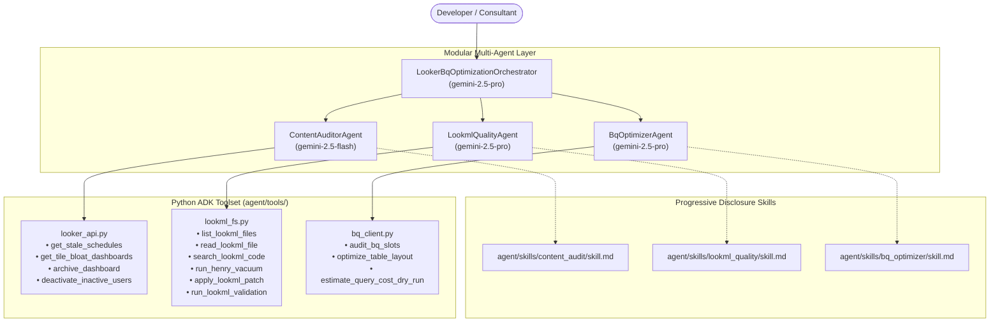

# Looker & BigQuery Optimizer ADK Agent

An enterprise-grade, autonomous Looker instance performance auditor, LookML refactoring specialist, and BigQuery compute optimizer built with the **Google Agent Development Kit (ADK)**, Google Cloud Vertex AI, and Google PSO (Professional Services Organization) benchmarks.

---

## 1. Modular, Spec-Driven Multi-Agent Architecture

To prevent context window dilution ("context rot"), this system uses a **Master Orchestrator (`root_agent`)** that coordinates with three specialized, domain-focused sub-agents. Each sub-agent loads its highly detailed markdown recipes (**Skills**) progressively on demand.



---

## 2. Directory Structure

```text
looker-healthcheck-agent/
├── .env                        # Environment configurations (GCP Project ID, Looker API keys, Tooling paths)
├── requirements.txt            # Python dependencies (google-adk, looker-sdk, google-cloud-bigquery)
├── agent/
│   ├── __init__.py             # Exports root_agent and sub-agents
│   ├── agent.py                # Core Orchestration file (declares root_agent and sub-agents)
│   ├── tools/                  # Python functions decorated for ADK execution
│   │   ├── __init__.py
│   │   ├── looker_api.py       # Looker API 4.0 calls (dashboards, schedules, user deactivation, KPIs)
│   │   ├── lookml_fs.py        # LookML file read/write, search, and looker-cli/Henry wrappers
│   │   └── bq_client.py        # BigQuery Client (INFORMATION_SCHEMA, Table layout, Dry-runs)
│   └── skills/                 # Progressive-disclosure skill packages
│       ├── content_audit/
│       │   └── skill.md        # Recipes for stale schedules, folder cleanups, and tile bloat
│       ├── lookml_quality/
│       │   └── skill.md        # Recipes for henry vacuuming, metadata checklist, and LookML linter
│       └── bq_optimizer/
│           └── skill.md        # Recipes for slot reservation, partitioning, clustering, and join orders
├── main.py                     # CLI & Web UI entrypoint (:8080)
└── AUDIT_REPORT.md             # Generated executive healthcheck report
```

---

## 3. Sub-Agent Breakdown & Diagnostic Recipes

### 📊 Sub-Agent 1: Content & Administration Auditor (`ContentAuditorAgent`)
* **Model**: `gemini-2.5-flash`
* **Skill Playbook**: [`agent/skills/content_audit/skill.md`](file:///Users/sampitcher/Documents/Projects/looker-healthcheck-agent/agent/skills/content_audit/skill.md)
* **Tools**: `get_stale_schedules`, `get_tile_bloat_dashboards`, `archive_dashboard`, `deactivate_inactive_users`
* **Key Diagnostic Recipes**:
  1. **Tile Bloat (>25 Tiles)**: Deconstructs dashboards exceeding 25 tiles into tabbed sections or linked drilldowns. Detects merged queries and unneeded hidden columns.
  2. **Zombie Schedules**: Identifies and deactivates schedules owned by users inactive for >90 days. Staggers hourly schedules away from `:00`.
  3. **License Reclamation**: Flags users with zero logins in >90 days for license deactivation.

---

### 🛠️ Sub-Agent 2: LookML Quality Specialist (`LookmlQualityAgent`)
* **Model**: `gemini-2.5-pro`
* **Skill Playbook**: [`agent/skills/lookml_quality/skill.md`](file:///Users/sampitcher/Documents/Projects/looker-healthcheck-agent/agent/skills/lookml_quality/skill.md)
* **Tools**: `run_henry_vacuum`, `apply_lookml_patch`, `list_lookml_files`, `read_lookml_file`, `search_lookml_code`, `run_lookml_validation`
* **Key Diagnostic Recipes**:
  1. **Henry Vacuuming**: Identifies explores, views, and dimensions with 0 queries in 90 days.
  2. **Primary Key Enforcement**: Enforces `primary_key: yes` on every view to eliminate symmetric aggregation fanout errors.
  3. **Datagroup Caching**: Replaces static `persist_for` with event-driven `datagroup` triggers linked to ETL updates to reach **> 50.0% Cache Hit Rate**.

---

### ⚡ Sub-Agent 3: BigQuery Engine Optimizer (`BqOptimizerAgent`)
* **Model**: `gemini-2.5-pro`
* **Skill Playbook**: [`agent/skills/bq_optimizer/skill.md`](file:///Users/sampitcher/Documents/Projects/looker-healthcheck-agent/agent/skills/bq_optimizer/skill.md)
* **Tools**: `audit_bq_slots`, `optimize_table_layout`, `estimate_query_cost_dry_run`
* **Key Diagnostic Recipes**:
  1. **Slot Starvation Detection**: Audits `INFORMATION_SCHEMA.JOBS_TIMELINE_BY_PROJECT` for reservation ceiling timeouts. Recommends dedicated BI slot reservations and PDT billing project overrides.
  2. **Daily Partitioning & Ordered Clustering**: Converts monthly partitions to Daily, and orders clusters by `[filter_columns, foreign_keys]`.
  3. **SQL Refactoring**: Replaces analytic CTE windows with the `QUALIFY` clause.
  4. **Aggregate Awareness**: Injects `aggregate_table` blocks into LookML models to eliminate full table scans on high-level rollups.

---

## 4. Getting Started

### 1. Install Dependencies
```bash
python3 -m venv .venv
source .venv/bin/activate
pip install -r requirements.txt
```

### 2. Configure Environment (`.env`)
```bash
# Google Vertex AI Configuration for ADK
GOOGLE_GENAI_USE_VERTEXAI=true
GOOGLE_CLOUD_PROJECT="your-gcp-project-id"
GOOGLE_CLOUD_LOCATION="us-central1"

# Looker API Credentials
LOOKERSDK_BASE_URL="https://your-instance.looker.app"
LOOKERSDK_CLIENT_ID="your_client_id"
LOOKERSDK_CLIENT_SECRET="your_client_secret"
LOOKER_PROJECT_ID="thelook-antigravity"

# Tooling & Repository Paths
LOOKER_CLI_PATH="~/.local/bin/looker-cli"
LOOKML_PROJECT_PATH="~/Documents/Projects/thelook-antigravity"
```

### 3. Running the Multi-Agent System

#### Interactive ADK Execution
Import and run the `root_agent` or any specialized sub-agent:
```python
from agent.agent import root_agent, content_agent, lookml_agent, bq_agent

# Run full healthcheck orchestration
response = root_agent.run("Perform a full 3-pillar healthcheck audit on our Looker instance and BigQuery backend.")
```

#### CLI Healthcheck Audit
```bash
python main.py
```

#### Web Dashboard
```bash
python main.py --web
```

---

## 5. License
Apache-2.0
