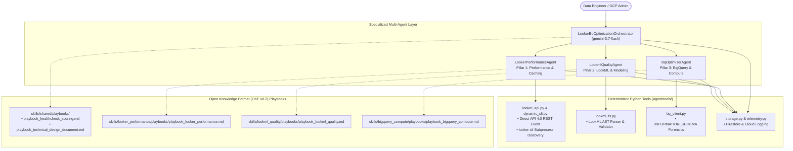

# 🚀 Looker & BigQuery Healthcheck Agent

> **An autonomous, multi-agent diagnostics engine that audits Looker instance performance, enforces LookML modeling quality, optimizes BigQuery warehouse compute, and compiles production-grade Technical Design Documents (TDD).**

Built with the **Google Agent Development Kit (ADK)**, **Gemini 3.7 / 2.5**, **Looker API 4.0**, and grounded in **Google Cloud PSO benchmarks** and the **Open Knowledge Format (OKF v0.2)**.

---

## 📑 Table of Contents
1. [What It Does & How It Helps](#1-what-it-does--how-it-helps)
2. [Architecture & OKF Standards](#2-architecture--okf-standards)
3. [Setup & Authentication Guide](#3-setup--authentication-guide)
4. [Running the Agent](#4-running-the-agent)
5. [Telemetry, Observability & Google Cloud Logging](#5-telemetry-observability--google-cloud-logging)
6. [Evaluation & Verification](#6-evaluation--verification)

---

## 1. What It Does & How It Helps

The **Looker & BigQuery Healthcheck Agent** replaces tedious manual auditing with autonomous multi-agent inquests across your entire BI and data warehouse stack.

```
                           THE 3 HEALTHCHECK PILLARS
 ┌─────────────────────────┬─────────────────────────┬─────────────────────────┐
 │ PILLAR 1: LOOKER PERF   │ PILLAR 2: LOOKML QUALITY│ PILLAR 3: BIGQUERY      │
 ├─────────────────────────┼─────────────────────────┼─────────────────────────┤
 │ • Query Phase Breakdown │ • Primary Key Integrity │ • Partition & Cluster   │
 │ • JVM vs DB Overhead    │ • Explicit Joins        │ • Slot Contention Curve │
 │ • Dashboard Tile Bloat  │ • Masked Foreign Keys   │ • Memory & Disk Spills  │
 │ • Datagroup ETL Caching │ • Snake_case Naming     │ • Aggregate Awareness   │
 └─────────────────────────┴─────────────────────────┴─────────────────────────┘
```

### How It Helps Your Team:
* **Pinpoint Query Bottlenecks in Seconds**: Dissects `system__activity/query_metrics` into database runtime, connection queue wait times, and Looker JVM overhead.
* **Eliminate Warehouse Slot Starvation & Costs**: Flags unpartitioned multi-gigabyte table scans and prescribes exact BigQuery SQL DDL to partition and cluster tables.
* **Modernize LookML Semantics & Prevent Fanouts**: Identifies missing primary keys causing heavy `SUM(DISTINCT ...)` symmetric aggregate hashing, unmasked foreign keys, and missing field descriptions.
* **Prepare Explores for Conversational Analytics & Gemini**: Audits field picker hygiene, suggestions caching, and metadata readiness for Natural Language search.
* **Authoritative OKF v0.2 Technical Design Document (TDD)**: Compiles an executive scorecard, 30-check audit table, copy-paste LookML refactorings, and BigQuery DDL into a standardized Markdown report (`TECHNICAL_DESIGN_DOCUMENT.md`).

---

## 2. Architecture & OKF Standards

The system operates as a **Star Topology Multi-Agent Hierarchy** powered by Google ADK. A master supervisor orchestrates three domain-specific subagents:



### Open Knowledge Format (OKF v0.2) Standard
All diagnostic playbooks, references, and benchmarks adhere strictly to Google Cloud's **Open Knowledge Format (OKF v0.2)**:
* **YAML Frontmatter**: Structured metadata with `type: Playbook`, `status: stable`, `tags`, and attested sources.
* **30-Check Master Scoring Standard**: Governed by [`skills/shared/playbooks/playbook_healthcheck_scoring.md`](skills/shared/playbooks/playbook_healthcheck_scoring.md), rolling up checks into Pillar Scores (0–100) and an overall Instance Health Grade.
* **Progressive Disclosure**: Subagents dynamically load only the relevant playbooks into their prompt context as needed via the OKF Skills Registry.

---

## 3. Setup & Authentication Guide

### 1. Prerequisites
* **Python 3.10+** (or [`uv`](https://github.com/astral-sh/uv) package manager)
* **Google Cloud SDK (`gcloud`)**
* **Looker CLI (`looker-cli`)**

---

### 2. Git Clone & Dependencies

```bash
git clone https://github.com/sam-pitcher/looker-healthcheck-agent.git
cd looker-healthcheck-agent

# Using uv (Fastest):
uv venv
source .venv/bin/activate
uv pip install -r requirements.txt

# Or using standard python venv:
python3 -m venv .venv
source .venv/bin/activate
pip install -r requirements.txt
```

---

### 3. Google Cloud Authentication

The agent supports **Cross-Project User OAuth (ADC)**. Your single identity (e.g. `your-email@google.com`) can run the agent in **Project A** while querying BigQuery tables in **Project B**:

```bash
# Authenticate Application Default Credentials (ADC):
gcloud auth application-default login
```

* **Agent Runtime (Project A)**: Uses Vertex AI Gemini models and Google Cloud Logging (`GOOGLE_CLOUD_PROJECT`).
* **BigQuery Forensic Analysis (Project B)**: Queries `INFORMATION_SCHEMA` and table schemas in the target data warehouse (`TARGET_BIGQUERY_PROJECT`).

---

### 4. Looker Instance Authentication (Zero-Secret OAuth)

The agent connects to Looker via **User OAuth** through `looker-cli`. You do not need to store static client secrets:

```bash
# 1. Register your Looker instance host:
looker-cli profile add default --host "yourcompany.looker.app" --port 443

# 2. Authenticate via browser OAuth:
looker-cli session login --oauth --client-id com.looker.cli
```

*The agent automatically inherits your active OAuth token, base URL, and refresh session from `~/.config/looker-cli/config.yaml`.*

---

### 5. Environment Configuration (`.env`)

Copy `.env.example` to create your local `.env`:

```bash
cp .env.example .env
```

Configure your target scopes:

```ini
# ==============================================================================
# 1. AGENT RUNNER INFRASTRUCTURE (Vertex AI / Gemini & Logging)
# ==============================================================================
GOOGLE_GENAI_USE_VERTEXAI=true
GOOGLE_CLOUD_PROJECT=your-agent-runner-project
GOOGLE_CLOUD_LOCATION=us-central1
AGENT_MODEL=gemini-3.7-flash

# Firestore State & Audit Persistence
FIRESTORE_DATABASE=looker-healthcheck-db
FIRESTORE_COLLECTION=looker_healthchecks

# ==============================================================================
# 2. TARGET LOOKER INSTANCE
# ==============================================================================
# Dynamically loaded from ~/.config/looker-cli/config.yaml (or override manually):
LOOKERSDK_BASE_URL=https://yourcompany.looker.app

# ==============================================================================
# 3. TARGET BIGQUERY DATA WAREHOUSE
# ==============================================================================
TARGET_BIGQUERY_PROJECT=your-target-bigquery-project
TARGET_BIGQUERY_DATASET=your_default_dataset
TARGET_BIGQUERY_LOCATION=US
```

---

## 4. Running the Agent

### Mode 1: Interactive Agent Web Chat (Recommended)
Launch the official Google ADK chat UI:

```bash
uv run adk web
```

Open **`http://localhost:8000`** in your browser and interact naturally:
* *"Run a complete 3-pillar healthcheck on the 'ecommerce' model."*
* *"Profile query latency phases and identify the top slow queries from the last 7 days."*
* *"Audit our LookML views for missing primary keys and unmasked foreign keys."*
* *"Check BigQuery slot contention and table partitioning layout."*
* *"Compile and save the Technical Design Document."*

---

### Mode 2: Headless CLI & CI/CD Audits
Execute automated batch audits directly from the command line:

```bash
# Run audit across discovered models:
python main.py

# Run audit scoped to a specific model:
python main.py --model=ecommerce
```
* Compiles `TECHNICAL_DESIGN_DOCUMENT.md` at the repository root.
* Persists structured audit metrics to Firestore (`looker_healthchecks`).
* Returns exit code `0` on healthy status (ideal for CI/CD gates).

---

## 5. Telemetry, Observability & Google Cloud Logging

Every agent turn, tool call, query latency, subagent transfer, and diagnostic error is streamed structured to **Google Cloud Logging** under the log channel:

```
projects/<GOOGLE_CLOUD_PROJECT>/logs/looker_healthcheck_telemetry
```

---

### 🔍 Google Cloud Logs Explorer Queries

Copy and paste these queries into [Google Cloud Logs Explorer](https://console.cloud.google.com/logs/query):

#### 1. Filter Trace by Session ID:
```sql
logName="projects/sampitcher-playground/logs/looker_healthcheck_telemetry"
(jsonPayload.data.session_id="YOUR_SESSION_ID" OR jsonPayload.session_id="YOUR_SESSION_ID")
```

#### 2. Inspect Generated SQL (Looker SQL Runner & BigQuery):
```sql
logName="projects/sampitcher-playground/logs/looker_healthcheck_telemetry"
(jsonPayload.tool_name="run_bq_query" OR jsonPayload.tool_name="get_query_sql" OR jsonPayload.data.tool_name="run_bq_query" OR jsonPayload.data.tool_name="get_query_sql")
```

#### 3. Inspect System Activity `run_inline_query` Calls:
```sql
logName="projects/sampitcher-playground/logs/looker_healthcheck_telemetry"
(jsonPayload.tool_name="run_inline_query" OR jsonPayload.data.tool_name="run_inline_query")
```

#### 4. Find All Tool Execution Errors & Warnings:
```sql
logName="projects/sampitcher-playground/logs/looker_healthcheck_telemetry"
(jsonPayload.data.status="ERROR" OR jsonPayload.data.result_preview=~"Error" OR severity >= WARNING)
```

---

### 💻 Stream Live Telemetry in Terminal via `gcloud`

```bash
gcloud logging read   'logName="projects/sampitcher-playground/logs/looker_healthcheck_telemetry"'   --project=sampitcher-playground   --limit=25   --format="table(timestamp, jsonPayload.event, jsonPayload.data.agent_name, jsonPayload.data.tool_name, jsonPayload.data.duration_ms)"
```

---

## 6. Evaluation & Verification

Verify the entire multi-agent toolchain and OKF knowledge graph with the automated evaluation suite:

```bash
# Run unit & deterministic tool verification:
PYTHONPATH=. python3 evals/test_tools.py

# Run comprehensive 4-layer evaluation suite:
python3 -u evals/run_evals.py
```

---

## 📄 License
Apache-2.0
