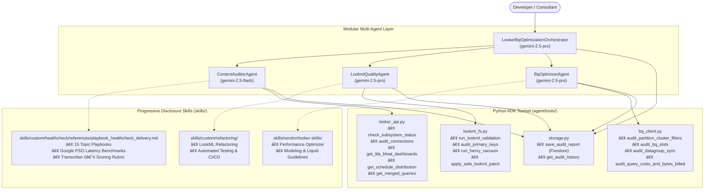

# Looker & BigQuery Optimizer ADK Agent

An enterprise-grade, autonomous Looker instance performance auditor, LookML refactoring specialist, and BigQuery compute optimizer built with the **Google Agent Development Kit (ADK)**, Google Cloud Vertex AI, and Google PSO (Professional Services Organization) benchmarks.

---

## 1. Modular, Spec-Driven Multi-Agent Architecture

To prevent context window dilution ("context rot"), this system uses a **Master Orchestrator (`root_agent`)** that coordinates with three specialized, domain-focused sub-agents. Each agent draws upon domain-specific **Skill Playbooks** and executes deterministic Python **ADK Tools**.



---

## 2. Directory Structure

```text
looker-healthcheck-agent/
├── .env                              # GCP Project ID, Looker API keys, Firestore config
├── requirements.txt                  # google-adk, looker-sdk, google-cloud-bigquery, google-cloud-firestore
├── main.py                           # CLI & Interactive Web Hub entrypoint (:8080)
├── agent/
│   ├── __init__.py                   # Package exports (root_agent, sub-agents, tools)
│   ├── agent.py                      # Multi-Agent orchestration declarations & instructions
│   ├── skills_registry.py            # Dynamic markdown skill loader & indexer
│   ├── prompts/                      # Sub-agent runtime system prompts
│   │   ├── content_auditor.md        # Pillar 1 Auditor instructions
│   │   ├── lookml_quality.md         # Pillar 2 Quality Specialist instructions
│   │   └── bq_optimizer.md           # Pillar 3 BigQuery Optimizer instructions
│   └── tools/                        # Deterministic ADK execution tools
│       ├── __init__.py
│       ├── looker_api.py             # Looker API 4.0 calls (Subsystems, connections, schedules, KPIs)
│       ├── lookml_fs.py              # LookML file read/write, AST parsing, and safe git patching
│       ├─â”├── skills/
│   ├── custom/                       # Healthcheck & Refactoring domain knowledge
│   │   ├── healthcheck/
│   │   │   ├── SKILL.md              # Looker healthcheck master entrypoint
│   │   │   ├── playbooks/            # 🎯 Tier 1 & 2: Strategic & Domain Playbooks
│   │   │   │   ├── playbook_healthcheck_delivery.md     # Master 4-Pillar Delivery Playbook
│   │   │   │   ├── playbook_looker_performance.md       # 4-Step progressive isolation & triage
│   │   │   │   ├── playbook_lookml_quality.md           # LookML style & modeling quality standards
│   │   │   │   ├── playbook_content_governance.md       # 90-day 3-stage deprecation & Henry vacuum
│   │   │   │   └── playbook_transcriber_scoring.md      # Official 0–4 scoring rubric
│   │   │   └── references/           # 🔧 Tier 3: Technical Recipes & Telemetry Banks
│   │   │       ├── benchmarks.md                        # Google Cloud PSO 12-stage latency benchmarks
│   │   │       ├── query_outliers_diagnosis.md          # Slow query outlier isolation
│   │   │       ├── history_query_analysis.md            # Persona & error rate profiling
│   │   │       ├── large_dashboards_optimization.md     # >25 tile rule & auto-refresh
│   │   │       ├── single_dashboard_optimization.md    # 10-point forensic single dashboard checklist
│   │   │       ├── content_delivery_schedules.md        # Top-of-hour schedule stacking & zombie crons
│   │   │       ├── merged_queries_remediation.md        # In-memory merged query elimination
│   │   │       ├── aggregate_awareness_and_architecture.md # Aggregate tables & Hub-Spoke
│   │   │       ├── development_workflows_and_ci.md      # LookML data tests & CI/CD pipelines
│   │   │       ├── security_roles_and_access_control.md # GBAC & access grant security
│   │   │       └── system_activity_queries.md           # System Activity JSON query bank
│   │   └── refactoring/
│   │       └── SKILL.md              # LookML refactoring & data test generation
│   └── vendor/looker-skills/         # Upstream Google Cloud Looker developer skills
└── terraform/                        # Cloud Run & Firestore infrastructure as code
```

---

## 3. The 30-Check Diagnostic Framework

The agent executes an exhaustive 30-check audit across 3 core pillars, evaluating both PASSED and FAILING checks:

| Check ID | Pillar | Diagnostic Check | Recommended Skill / Playbook |
| :--- | :--- | :--- | :--- |
| **`P1-01`** | Pillar 1 | **Subsystem Status & Endpoint Health** | [`benchmarks.md`](skills/custom/healthcheck/references/benchmarks.md) |
| **`P1-02`** | Pillar 1 | **Database Connections & Pool Limits** | [`playbook_looker_performance.md`](skills/custom/healthcheck/playbooks/playbook_looker_performance.md) |
| **`P1-03`** | Pillar 1 | **Dashboard Query Density (>25 Tiles)** | [`large_dashboards_optimization.md`](skills/custom/healthcheck/references/large_dashboards_optimization.md) |
| **`P1-04`** | Pillar 1 | **Auto-Refresh Rate Limits (<30m)** | [`large_dashboards_optimization.md`](skills/custom/healthcheck/references/large_dashboards_optimization.md) |
| **`P1-05`** | Pillar 1 | **Schedule Time Spacing & Distribution** | [`content_delivery_schedules.md`](skills/custom/healthcheck/references/content_delivery_schedules.md) |
| **`P1-06`** | Pillar 1 | **Query Concurrency Peaks & Queue Limits** | [`benchmarks.md`](skills/custom/healthcheck/references/benchmarks.md) |
| **`P1-07`** | Pillar 1 | **Stale Content & Unused Folder Purge** | [`playbook_content_governance.md`](skills/custom/healthcheck/playbooks/playbook_content_governance.md) |
| **`P1-08`** | Pillar 1 | **Frontend Filter Enforcement** | [`single_dashboard_optimization.md`](skills/custom/healthcheck/references/single_dashboard_optimization.md) |
| **`P1-09`** | Pillar 1 | **Merged Queries In Production** | [`merged_queries_remediation.md`](skills/custom/healthcheck/references/merged_queries_remediation.md) |
| **`P1-10`** | Pillar 1 | **Legacy Feature Deprecation Audit** | [`playbook_content_governance.md`](skills/custom/healthcheck/playbooks/playbook_content_governance.md) |
| **`P2-11`** | Pillar 2 | **LookML Syntax & Compilation Health** | [`development_workflows_and_ci.md`](skills/custom/healthcheck/references/development_workflows_and_ci.md) |
| **`P2-12`** | Pillar 2 | **Primary Key Integrity (`primary_key: yes`)** | [`playbook_lookml_quality.md`](skills/custom/healthcheck/playbooks/playbook_lookml_quality.md) |
| **`P2-13`** | Pillar 2 | **Explicit Join Relationships (`relationship:`)** | [`playbook_lookml_quality.md`](skills/custom/healthcheck/playbooks/playbook_lookml_quality.md) |
| **`P2-14`** | Pillar 2 | **Dead Field Detection (Henry Vacuum)** | [`playbook_content_governance.md`](skills/custom/healthcheck/playbooks/playbook_content_governance.md) |
| **`P2-15`** | Pillar 2 | **Raw Foreign Key & Technical Field Exposure** | [`playbook_lookml_quality.md`](skills/custom/healthcheck/playbooks/playbook_lookml_quality.md) |
| **`P2-16`** | Pillar 2 | **Folder Structure & File Hygiene** | [`aggregate_awareness_and_architecture.md`](skills/custom/healthcheck/references/aggregate_awareness_and_architecture.md) |
| **`P2-17`** | Pillar 2 | **Standard snake_case Naming Conventions** | [`playbook_lookml_quality.md`](skills/custom/healthcheck/playbooks/playbook_lookml_quality.md) |
| **`P2-18`** | Pillar 2 | **User-Facing Metadata Descriptions** | [`playbook_lookml_quality.md`](skills/custom/healthcheck/playbooks/playbook_lookml_quality.md) |
| **`P2-19`** | Pillar 2 | **Explore Join Bloat (>6 Joins)** | [`playbook_looker_performance.md`](skills/custom/healthcheck/playbooks/playbook_looker_performance.md) |
| **`P2-20`** | Pillar 2 | **Client-Side Table Calculation Bloat** | [`playbook_looker_performance.md`](skills/custom/healthcheck/playbooks/playbook_looker_performance.md) |
| **`P3-21`** | Pillar 3 | **Partition & Cluster Filter Alignment** | [`playbook_looker_performance.md`](skills/custom/healthcheck/playbooks/playbook_looker_performance.md) |
| **`P3-22`** | Pillar 3 | **BigQuery BI Engine Acceleration** | [`aggregate_awareness_and_architecture.md`](skills/custom/healthcheck/references/aggregate_awareness_and_architecture.md) |
| **`P3-23`** | Pillar 3 | **PDT Build Failures & Monitoring** | [`playbook_looker_performance.md`](skills/custom/healthcheck/playbooks/playbook_looker_performance.md) |
| **`P3-24`** | Pillar 3 | **Incremental PDT Strategy** | [`playbook_looker_performance.md`](skills/custom/healthcheck/playbooks/playbook_looker_performance.md) |
| **`P3-25`** | Pillar 3 | **Datagroup Caching & ELT Sync** | [`benchmarks.md`](skills/custom/healthcheck/references/benchmarks.md) |
| **`P3-26`** | Pillar 3 | **OAuth & User Attribute Cache Sharing** | [`security_roles_and_access_control.md`](skills/custom/healthcheck/references/security_roles_and_access_control.md) |
| **`P3-27`** | Pillar 3 | **Aggregate Awareness Rollup Candidates** | [`aggregate_awareness_and_architecture.md`](skills/custom/healthcheck/references/aggregate_awareness_and_architecture.md) |
| **`P3-28`** | Pillar 3 | **Join Key SQL Syntax (No CONCAT/LOWER in `sql_on`)** | [`playbook_looker_performance.md`](skills/custom/healthcheck/playbooks/playbook_looker_performance.md) |
| **`P3-29`** | Pillar 3 | **Table Denormalization & Query Runtime** | [`query_outliers_diagnosis.md`](skills/custom/healthcheck/references/query_outliers_diagnosis.md) |
| **`P3-30`** | Pillar 3 | **BigQuery Query Cost & Bytes Billed** | [`playbook_looker_performance.md`](skills/custom/healthcheck/playbooks/playbook_looker_performance.md) |)** | [`playbook_looker_performance.md`](skills/custom/healthcheck/references/playbook_looker_performance.md) |
| **`P3-29`** | Pillar 3 | **Table Denormalization & Query Runtime** | [`query_outliers_diagnosis.md`](skills/custom/healthcheck/references/query_outliers_diagnosis.md) |
| **`P3-30`** | Pillar 3 | **BigQuery Query Cost & Bytes Billed** | [`playbook_looker_performance.md`](skills/custom/healthcheck/references/playbook_looker_performance.md) |

---

## 4. Getting Started

### 1. Install Dependencies
```bash
python3 -m venv .venv
source .venv/bin/activate
pip install -r requirements.txt
```

### 2. Configure Environment (`.env`)
```bash
# Google Cloud & Vertex AI Configuration
GOOGLE_GENAI_USE_VERTEXAI=true
GOOGLE_CLOUD_PROJECT="your-gcp-project-id"
GOOGLE_CLOUD_LOCATION="us-central1"

# Firestore Persistence (Audit History & Trends)
FIRESTORE_DATABASE="looker-healthcheck-db"
FIRESTORE_COLLECTION="looker_healthchecks"

# Looker API 4.0 Credentials
LOOKERSDK_BASE_URL="https://your-instance.looker.app"
LOOKERSDK_CLIENT_ID="your_client_id"
LOOKERSDK_CLIENT_SECRET="your_client_secret"
LOOKER_PROJECT_ID="your_looker_project_id"
LOOKER_VERIFY_SSL="true"

# Local LookML Repository Path
LOOKML_PROJECT_PATH="/path/to/your/lookml/repo"
LOOKER_CLI_PATH="~/.local/bin/looker-cli"
```

### 3. Running Audits

#### CLI Execution (Instance-Wide or Model-Scoped)
```bash
# Run full 30-check audit across all models
python main.py

# Run audit scoped to a specific LookML model
python main.py --model=ecommerce_analytics
```

#### Interactive Web Hub
```bash
python main.py --web
# Open http://localhost:8080 to trigger audits and view live telemetry
```

#### Programmatic Agent Execution
```python
from agent.agent import root_agent

# Run full healthcheck orchestration
response = root_agent.run("Perform a full 3-pillar healthcheck audit on our Looker instance.")
print(response)
```

---

## 5. Persistence & Delivery

* **Direct User Relay**: Findings are presented thematically in chat responses, console output, and web UI.
* **Firestore Telemetry**: Every audit is persisted to Firestore (`looker_healthchecks` collection) with model scoping and timestamps for time-series trend analysis (`get_audit_history()`).
* **Safe Git Branching**: LookML fixes are applied to isolated Git branches with automated syntax compilation validation and instant rollback on failure.

---

## 6. License
Apache-2.0
