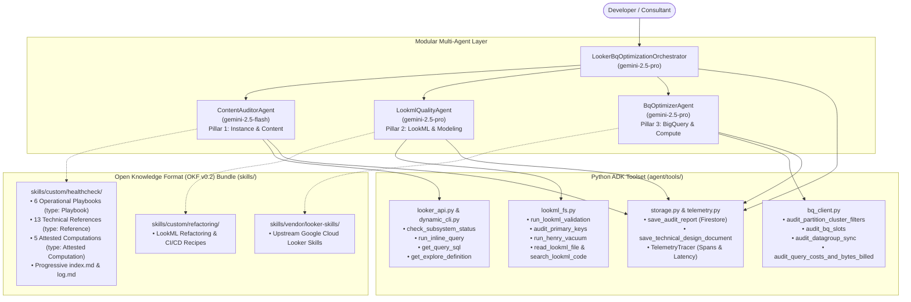

# Looker & BigQuery Healthcheck Multi-Agent

> **An enterprise-grade, autonomous Looker instance performance auditor, LookML quality advisor, and BigQuery compute optimizer built with the Google Agent Development Kit (ADK), Gemini 2.5 Pro/Flash, Looker 4.0 APIs, and Google PSO (Professional Services Organization) benchmarks.**

---

## 📑 Table of Contents
1. [Executive Overview](#1-executive-overview)
2. [Multi-Agent Architecture & Topology](#2-multi-agent-architecture--topology)
3. [Core Architectural Design Principles](#3-core-architectural-design-principles)
4. [Directory Structure](#4-directory-structure)
5. [The 30-Check Diagnostic Framework](#5-the-30-check-diagnostic-framework)
6. [Prerequisites & Step-by-Step Setup Guide](#6-prerequisites--step-by-step-setup-guide)
7. [How to Run the Agent](#7-how-to-run-the-agent)
8. [Telemetry, Tracing & Persistence](#8-telemetry-tracing--persistence)
9. [Evaluation & Test Suite](#9-evaluation--test-suite)
10. [License](#10-license)

---

## 1. Executive Overview

The **Looker & BigQuery Healthcheck Agent** is an autonomous AI assistant designed to systematically inspect, diagnose, and optimize Looker instances, LookML modeling repositories, and underlying BigQuery warehouses.

### Key Capabilities:
* **100% Model & Instance Agnostic**: Dynamically discovers models, explores, views, and projects at runtime without hardcoded instance assumptions.
* **Adherence to Open Knowledge Format (OKF v0.2)**: Entire knowledge architecture adheres strictly to Google Cloud's [Open Knowledge Format](https://cloud.google.com/blog/products/data-analytics/how-the-open-knowledge-format-can-improve-data-sharing?e=a) with rich YAML frontmatter, Attested Computations, Trust Tiers, progressive disclosure `index.md` files, and chronological `log.md` files.
* **Autonomous 3-Way Triage & 5-Vector Query Forensics**: Deconstructs query latency into Database Execution, Looker JVM Overhead, Connection Pool Contention, SQL/Join Inefficiencies, and Aggregate Awareness candidates (preserving legitimate unfiltered lifetime metrics).
* **Read-Only LookML Advisory**: Inspects LookML files, AST models, and compile plans, and presents surgical code improvements as clear Markdown diffs without directly modifying the Git repository.
* **Manifest-as-Code Skill Ingestion**: Tracks external Google Cloud skills via declarative `skills.yaml` with selective Git Sparse-Checkout to eliminate repository bloat and submodule friction.
* **Dual-Layer Telemetry & State Persistence**: Generates publication-grade architecture specifications (`TECHNICAL_DESIGN_DOCUMENT.md`) and persists structured time-series audit telemetry to Google Cloud Firestore (`looker-healthcheck-db`).

---

## 2. Multi-Agent Architecture & Topology

To eliminate context window dilution ("context rot"), the system uses a hierarchical multi-agent structure orchestrated by a master coordinator and three specialized sub-agents:



---

## 3. Core Architectural Design Principles

### A. Open Knowledge Format (OKF v0.2) Standard Adherence
The knowledge architecture complies 100% with the [Open Knowledge Format (OKF v0.2)](https://github.com/GoogleCloudPlatform/knowledge-catalog/blob/main/okf/SPEC.md):
* **Concept Documents (§4)**: Every document contains parseable YAML frontmatter declaring non-empty `type:` (`Playbook`, `Reference`, `Skill`, `Attested Computation`, `Technical Design Document`), `status: stable`, `tags: [...]`, and provenance `sources: [...]`.
* **Trust Tiers (§5.3)**: Automated trust classification calculates `unverified`, `machine-confirmed`, or `human-reviewed` tiers based on cryptographic verifiers and human-in-the-loop approvals.
* **Progressive Disclosure (`index.md`) (§8 & §12)**: Directory-level indices provide high-level catalog summaries, with `okf_version: "0.2"` defined at the bundle root.
* **Chronological Logs (`log.md`) (§9)**: Every directory level maintains a standardized ISO-8601 `## YYYY-MM-DD` update history log.
* **Attested Computations (§10)**: Sanctioned queries (System Activity latency decomposition, BigQuery slot utilization timeline, bytes billed per model, table partition DDL) are encapsulated as executable contracts with typed `parameters:`, `runtime:`, `executor:`, and `attester:`.

### B. Separation of Tools vs. Skills
* **Deterministic Tools (`agent/tools/`)**: Pure Python functions that execute API calls, query BigQuery, parse LookML ASTs, or persist to Firestore. Tools contain zero hardcoded diagnostic rules.
* **Progressive Skills (`skills/`)**: Tool-agnostic Markdown playbooks and decision recipes adhering to OKF v0.2. The agent loads only the relevant playbook into its prompt context dynamically via `get_skill_content("playbook_name")`.

### C. Manifest-as-Code Skill Ingestion (`skills.yaml`)
External vendor skills from Google Cloud and Looker Open Source are declared in `skills.yaml` and sparse-checked out on demand via `python3 scripts/sync_skills.py`:
* **Zero Submodule Friction**: No `.gitmodules` or detached-`HEAD` states.
* **Selective Ingestion**: Only the 10 relevant skills are extracted onto disk, completely pruning unneeded onboarding tutorials and sample dashboards.
* **Gitignored Artifacts**: `skills/vendor/` is gitignored and treated as a build-time dependency directory.

### D. 5-Vector Query Forensic Framework
When diagnosing slow queries (even unfiltered queries), the agent evaluates all 5 root-cause vectors:
1. **Lifecycle Latency Breakdown**: Deconstructs `system__activity/query_metrics` (DB execution vs. connection wait vs. streaming).
2. **SQL & Join Analysis**: Automatically inspects physical SQL via `get_query_sql(query_id)` to catch redundant `LEFT JOIN`s or `SUM(DISTINCT ...)` symmetric aggregate fanouts.
3. **Aggregate Awareness Acceleration**: For valid full-history metrics (e.g. lifetime user orders), prescribes LookML `aggregate_table:` rollups instead of breaking business metrics with date filters.
4. **Warehouse Slot Contention**: Analyzes BigQuery slot saturation and execution stage shuffle spills via `INFORMATION_SCHEMA`.
5. **Concurrent Job Bursts**: Detects multi-tile dashboard pileups and top-of-hour (`:00`) cron scheduling collisions.

### E. Read-Only LookML Code Recommendations
The agent acts as a read-only advisor for your LookML code repository. When it identifies missing primary keys, fanout joins, or unpruned fields, it provides line-by-line Markdown diffs and code snippets for human review.

---

## 4. Directory Structure

```text
looker-healthcheck-agent/
├── .env                              # GCP Project ID, Looker API keys, Firestore config
├── .env.example                      # Template configuration file
├── skills.yaml                       # Declarative external skill dependencies manifest
├── pyproject.toml / requirements.txt # Python package dependencies
├── main.py                           # CLI & Interactive Web Hub entrypoint (:8080)
├── TECHNICAL_DESIGN_DOCUMENT.md      # OKF v0.2 Publication-Grade Architecture Spec
├── agent/                            # 🧠 Core Application & Multi-Agent Runtime
│   ├── __init__.py                   # Package exports (root_agent, sub-agents, tools)
│   ├── agent.py                      # Multi-Agent orchestration declarations & instructions
│   ├── skills_registry.py            # OKF v0.2 Dynamic Knowledge Registry & Validator
│   ├── telemetry.py                  # Execution tracer, latency tracking & Firestore recorder
│   ├── prompts/                      # Sub-agent runtime system prompts
│   │   ├── content_auditor.md        # Pillar 1 Auditor instructions
│   │   ├── lookml_quality.md         # Pillar 2 Quality Specialist instructions
│   │   └── bq_optimizer.md           # Pillar 3 BigQuery Optimizer instructions
│   └── tools/                        # Deterministic ADK execution tools
│       ├── __init__.py
│       ├── looker_api.py             # Looker API 4.0 calls (Subsystems, connections, schedules, KPIs)
│       ├── lookml_fs.py              # LookML AST parser, primary key, and dead field audits
│       ├── bq_client.py              # BigQuery compute, partition pruning & slot queries
│       ├── storage.py                # Dual-layer report & TDD persistence (Markdown & Firestore)
│       └── dynamic_cli.py            # Looker CLI meta-tree discovery & payload inspector
├── skills/                           # 📖 OKF v0.2 Knowledge Catalog (Bundle Root)
│   ├── index.md                      # Bundle Root Index (okf_version: "0.2")
│   ├── log.md                        # Bundle Update History Log
│   ├── custom/                       # In-house Healthcheck & Refactoring domain knowledge
│   │   ├── index.md & log.md         # Progressive disclosure index and update logs
│   │   ├── healthcheck/
│   │   │   ├── SKILL.md              # Looker healthcheck master entrypoint (type: Skill)
│   │   │   ├── index.md & log.md     # Healthcheck scope index and update logs
│   │   │   ├── playbooks/            # 🎯 Strategic & Domain Playbooks (type: Playbook)
│   │   │   │   ├── index.md          # Playbooks directory index
│   │   │   │   ├── playbook_healthcheck_delivery.md     # Master 4-Pillar Delivery Playbook
│   │   │   │   ├── playbook_looker_performance.md       # 4-Step progressive isolation & triage
│   │   │   │   ├── playbook_lookml_quality.md           # LookML style & modeling quality standards
│   │   │   │   ├── playbook_content_governance.md       # 90-day 3-stage deprecation & Henry vacuum
│   │   │   │   ├── playbook_transcriber_scoring.md      # Official 0–4 scoring rubric
│   │   │   │   └── playbook_technical_design_document.md# TDD authoring standards
│   │   │   ├── computations/         # ⚡ Attested Computations (type: Attested Computation)
│   │   │   │   ├── index.md          # Computations directory index
│   │   │   │   ├── query_latency_breakdown.md           # Looker query phase decomposition
│   │   │   │   ├── slot_consumption_timeline.md         # BigQuery 24-hr slot utilization
│   │   │   │   ├── bytes_billed_by_model.md             # BigQuery cost & data scan audit
│   │   │   │   ├── pdt_failure_event_log.md             # Looker PDT build failure event log
│   │   │   │   └── table_partition_ddl.md               # BigQuery fact table partitioning DDL
│   │   │   └── references/           # 🔧 Technical Recipes & Telemetry Banks (type: Reference)
│   │   │       ├── index.md          # References directory index
│   │   │       ├── benchmarks.md                        # Google Cloud PSO 12-stage latency benchmarks
│   │   │       ├── query_outliers_diagnosis.md          # 5-Vector slow query outlier isolation
│   │   │       ├── warehouse_optimization.md            # BigQuery slot & stage optimization
│   │   │       ├── history_query_analysis.md            # Persona & error rate profiling
│   │   │       ├── large_dashboards_optimization.md     # >25 tile rule & auto-refresh
│   │   │       ├── single_dashboard_optimization.md    # 10-point forensic single dashboard checklist
│   │   │       ├── content_delivery_schedules.md        # Top-of-hour schedule stacking & zombie crons
│   │   │       ├── merged_queries_remediation.md        # In-memory merged query elimination
│   │   │       ├── aggregate_awareness_and_architecture.md # Aggregate tables & Hub-Spoke
│   │   │       ├── development_workflows_and_ci.md      # LookML data tests & CI/CD pipelines
│   │   │       ├── security_roles_and_access_control.md # GBAC & access grant security
│   │   │       └── system_activity_queries.md           # System Activity JSON query bank
│   │   └── refactoring/
│   │       ├── SKILL.md              # LookML refactoring & migration skill
│   │       ├── index.md & log.md     # Refactoring index and update logs
│   │       └── references/           # Migration recipes and Henry guides
│   └── vendor/                       # Upstream sparse-synced skills (gitignored)
├── scripts/                          # 🛠️ Human & CI/CD Utility Tools (Offline only)
│   ├── apply_okf_standard.py         # Open Knowledge Format (OKF v0.2) build standardizer
│   ├── sync_skills.py                # Manifest-Driven sparse sync engine
│   ├── oauth_login.py                # Interactive Looker user OAuth browser login
│   └── inspect_session_traces.py     # Developer session trace log analyzer
├── evals/                            # 🧪 Comprehensive 4-Layer Evaluation Suite
│   ├── run_evals.py                  # Test suite runner (24 deterministic & OKF test cases)
│   ├── test_tools.py                 # Tool verification unit tests
│   ├── test_transcriber_scoring.py   # Transcriber 0-4 scoring rubric benchmarks
│   ├── test_okf_conformance.py       # OKF v0.2 normative conformance test suite
│   └── eval_agent_trajectories.py    # Multi-turn agent scenario simulations
└── terraform/                        # Cloud Run & Firestore infrastructure as code
```

---

## 5. The 30-Check Diagnostic Framework

The agent evaluates instances across an exhaustive 30-check diagnostic matrix spanning 3 core pillars:

| Check ID | Pillar | Diagnostic Check | Recommended Skill / Playbook |
| :--- | :--- | :--- | :--- |
| **`P1-01`** | Pillar 1 | **Subsystem Status & Endpoint Health** | [`benchmarks.md`](skills/custom/healthcheck/references/benchmarks.md) |
| **`P1-02`** | Pillar 1 | **Database Connections & Pool Limits** | [`playbook_looker_performance.md`](skills/custom/healthcheck/playbooks/playbook_looker_performance.md) |
| **`P1-03`** | Pillar 1 | **Dashboard Query Density (>25 Tiles)** | [`large_dashboards_optimization.md`](skills/custom/healthcheck/references/large_dashboards_optimization.md) |
| **`P1-04`** | Pillar 1 | **Auto-Refresh Rate Limits (<30m)** | [`large_dashboards_optimization.md`](skills/custom/healthcheck/references/large_dashboards_optimization.md) |
| **`P1-05`** | Pillar 1 | **Schedule Time Spacing & Distribution** | [`content_delivery_schedules.md`](skills/custom/healthcheck/references/content_delivery_schedules.md) |
| **`P1-06`** | Pillar 1 | **Query Concurrency Peaks & Queue Limits** | [`benchmarks.md`](skills/custom/healthcheck/references/benchmarks.md) |
| **`P1-07`** | Pillar 1 | **Stale Content & Unused Folder Purge** | [`playbook_content_governance.md`](skills/custom/healthcheck/playbooks/playbook_content_governance.md) |
| **`P1-08`** | Pillar 1 | **Frontend Filter Enforcement** | [`single_dashboard_optimization.md`](skills/custom/healthcheck/references/single_dashboard_optimization.md) |
| **`P1-09`** | Pillar 1 | **Merged Queries In Production** | [`merged_queries_remediation.md`](skills/custom/healthcheck/references/merged_queries_remediation.md) |
| **`P1-10`** | Pillar 1 | **Legacy Feature Deprecation Audit** | [`playbook_content_governance.md`](skills/custom/healthcheck/playbooks/playbook_content_governance.md) |
| **`P2-11`** | Pillar 2 | **LookML Syntax & Compilation Health** | [`development_workflows_and_ci.md`](skills/custom/healthcheck/references/development_workflows_and_ci.md) |
| **`P2-12`** | Pillar 2 | **Primary Key Integrity (`primary_key: yes`)** | [`playbook_lookml_quality.md`](skills/custom/healthcheck/playbooks/playbook_lookml_quality.md) |
| **`P2-13`** | Pillar 2 | **Explicit Join Relationships (`relationship:`)** | [`playbook_lookml_quality.md`](skills/custom/healthcheck/playbooks/playbook_lookml_quality.md) |
| **`P2-14`** | Pillar 2 | **Dead Field Detection (Henry Vacuum)** | [`playbook_content_governance.md`](skills/custom/healthcheck/playbooks/playbook_content_governance.md) |
| **`P2-15`** | Pillar 2 | **Raw Foreign Key & Technical Field Exposure** | [`playbook_lookml_quality.md`](skills/custom/healthcheck/playbooks/playbook_lookml_quality.md) |
| **`P2-16`** | Pillar 2 | **Folder Structure & File Hygiene** | [`aggregate_awareness_and_architecture.md`](skills/custom/healthcheck/references/aggregate_awareness_and_architecture.md) |
| **`P2-17`** | Pillar 2 | **Standard snake_case Naming Conventions** | [`playbook_lookml_quality.md`](skills/custom/healthcheck/playbooks/playbook_lookml_quality.md) |
| **`P2-18`** | Pillar 2 | **User-Facing Metadata Descriptions** | [`playbook_lookml_quality.md`](skills/custom/healthcheck/playbooks/playbook_lookml_quality.md) |
| **`P2-19`** | Pillar 2 | **Explore Join Bloat (>6 Joins)** | [`playbook_looker_performance.md`](skills/custom/healthcheck/playbooks/playbook_looker_performance.md) |
| **`P2-20`** | Pillar 2 | **Client-Side Table Calculation Bloat** | [`playbook_looker_performance.md`](skills/custom/healthcheck/playbooks/playbook_looker_performance.md) |
| **`P3-21`** | Pillar 3 | **Partition & Cluster Filter Alignment** | [`playbook_looker_performance.md`](skills/custom/healthcheck/playbooks/playbook_looker_performance.md) |
| **`P3-22`** | Pillar 3 | **BigQuery BI Engine Acceleration** | [`aggregate_awareness_and_architecture.md`](skills/custom/healthcheck/references/aggregate_awareness_and_architecture.md) |
| **`P3-23`** | Pillar 3 | **PDT Build Failures & Monitoring** | [`playbook_looker_performance.md`](skills/custom/healthcheck/playbooks/playbook_looker_performance.md) |
| **`P3-24`** | Pillar 3 | **Incremental PDT Strategy** | [`playbook_looker_performance.md`](skills/custom/healthcheck/playbooks/playbook_looker_performance.md) |
| **`P3-25`** | Pillar 3 | **Datagroup Caching & ELT Sync** | [`benchmarks.md`](skills/custom/healthcheck/references/benchmarks.md) |
| **`P3-26`** | Pillar 3 | **OAuth & User Attribute Cache Sharing** | [`security_roles_and_access_control.md`](skills/custom/healthcheck/references/security_roles_and_access_control.md) |
| **`P3-27`** | Pillar 3 | **Aggregate Awareness Rollup Candidates** | [`aggregate_awareness_and_architecture.md`](skills/custom/healthcheck/references/aggregate_awareness_and_architecture.md) |
| **`P3-28`** | Pillar 3 | **Join Key SQL Syntax (No CONCAT in `sql_on`)** | [`playbook_looker_performance.md`](skills/custom/healthcheck/playbooks/playbook_looker_performance.md) |
| **`P3-29`** | Pillar 3 | **Table Denormalization & Query Runtime** | [`query_outliers_diagnosis.md`](skills/custom/healthcheck/references/query_outliers_diagnosis.md) |
| **`P3-30`** | Pillar 3 | **BigQuery Query Cost & Bytes Billed** | [`warehouse_optimization.md`](skills/custom/healthcheck/references/warehouse_optimization.md) |

---

## 6. Prerequisites & Step-by-Step Setup Guide

### 1. Prerequisites
* **Python 3.10+** (or [`uv`](https://github.com/astral-sh/uv) package manager)
* **Google Cloud SDK (`gcloud`)**
* **Looker CLI (`looker-cli`)** or Python 3 browser access
* Target Looker Instance (User account for OAuth)

---

### 2. Installation

Clone the repository and install dependencies:

```bash
git clone https://github.com/sam-pitcher/looker-healthcheck-agent.git
cd looker-healthcheck-agent

# Using uv (Recommended):
uv venv
source .venv/bin/activate
uv pip install -r requirements.txt

# Or using standard pip:
python3 -m venv .venv
source .venv/bin/activate
pip install -r requirements.txt
```

---

### 3. Google Cloud Authentication (Vertex AI & BigQuery)

#### A. Standard Setup (Single Account)
To authenticate your environment for Vertex AI Gemini model execution, Firestore telemetry storage, and BigQuery `INFORMATION_SCHEMA` queries, run:

```bash
# Authenticate Application Default Credentials (ADC) for the Agent Runner:
gcloud auth application-default login
```
*This provides credentials for `GOOGLE_GENAI_USE_VERTEXAI=true`, Firestore (`looker-healthcheck-db`), and BigQuery SDK queries.*

#### B. Dual-Identity Setup (Different GCP Accounts for Agent Runner vs. Target Warehouse)
If your **Agent Runner Project** (e.g. `sampitcher-playground` via `admin@...`) is in a different account from your **Target Warehouse Project** (e.g. `looker-eng` via `sampitcher@google.com`):

```bash
# 1. Authenticate the Agent Runner identity with ADC:
gcloud auth application-default login

# 2. Authenticate your Target BigQuery identity in gcloud:
gcloud auth login your-warehouse-email@google.com
# (Or for Google internal accounts: gcert)

# 3. Verify both accounts are registered:
gcloud auth list
```
*When `TARGET_BIGQUERY_ACCOUNT=your-warehouse-email@google.com` is set in `.env`, the agent dynamically fetches isolated OAuth tokens for BigQuery while leaving Vertex AI and Firestore on the ADC runner account!*

---

### 4. Looker Instance Authentication (Zero-Secret OAuth)

The agent uses **Zero-Secret User OAuth** via `looker-cli` so you do not need to store static API client keys or secrets in your repository:

```bash
# Step 1: Set the target host in your Looker CLI profile
looker-cli profile add default --host "your-instance.looker.app" --port 443

# Step 2: Login via browser OAuth
looker-cli session login --oauth --client-id com.looker.cli
```

*Alternative: If using dev/self-signed SSL certificates, run the Python OAuth helper:*
```bash
python3 scripts/oauth_login.py --host your-instance.looker.app
```
*The agent will automatically inherit your user OAuth token, host, and refresh tokens from `~/.config/looker-cli/config.yaml`!*

---

### 5. Configure Environment (`.env`)

Copy the template configuration:
```bash
cp .env.example .env
```

Your `.env` cleanly separates your **Agent Runner Project** from the **Target Warehouse Project**:

```ini
# ==============================================================================
# 1. AGENT RUNNER INFRASTRUCTURE (Vertex AI LLM & Firestore Storage)
# ==============================================================================
# Your GCP Project used to run the agent LLM, Vertex AI, and Firestore
GOOGLE_GENAI_USE_VERTEXAI=true
GOOGLE_CLOUD_PROJECT=your-agent-runner-gcp-project
GOOGLE_CLOUD_LOCATION=us-central1

# Persistent Firestore Storage (Audit History & Trends)
FIRESTORE_DATABASE=looker-healthcheck-db
FIRESTORE_COLLECTION=looker_healthchecks

# ==============================================================================
# 2. TARGET LOOKER INSTANCE (Zero-Secret OAuth with looker-cli)
# ==============================================================================
# Dynamically inherited from ~/.config/looker-cli/config.yaml
LOOKER_CLI_PATH=~/.local/bin/looker-cli
# LookML code is streamed live from Looker via looker-cli (Zero local files required)

# ==============================================================================
# 3. TARGET BIGQUERY DATA WAREHOUSE (The Looker Instance's Data Project)
# ==============================================================================
# The GCP Project ID and Dataset where the client's BigQuery tables/views live
TARGET_BIGQUERY_PROJECT=your-target-customer-warehouse-project
TARGET_BIGQUERY_DATASET=the_look_ca
TARGET_BIGQUERY_LOCATION=US

# Optional: Separate Google Account email for BigQuery (for Dual-Identity setups)
TARGET_BIGQUERY_ACCOUNT=your-name@google.com
```

---

### 6. BigQuery `INFORMATION_SCHEMA` Access & Dual-Identity Setup

When auditing Pillar 3 (BigQuery slot saturation, partition alignment, and query costs), the agent accesses the target warehouse using one of the following methods:

1. **Dual-Identity Setup (Different GCP Accounts for Agent vs. Warehouse)**:
   If your Agent runner identity (`GOOGLE_CLOUD_PROJECT`) is different from the Google account that has access to the target BigQuery project:
   - Set `TARGET_BIGQUERY_ACCOUNT=your-name@google.com` in `.env`.
   - The agent will automatically use the active `gcloud` token for that specific account to query `TARGET_BIGQUERY_PROJECT`'s `INFORMATION_SCHEMA` while executing the agent in your runner project.
2. **Direct ADC Access (Same Identity)**:
   Your active Google identity from `gcloud auth application-default login` has `roles/bigquery.resourceViewer` and `roles/bigquery.metadataViewer` on `TARGET_BIGQUERY_PROJECT`.
3. **Service Account Impersonation (Cross-Project)**:
   If the target warehouse is in a separate client GCP project, impersonate the client's Looker service account:
   ```bash
   gcloud auth application-default login --impersonate-service-account=looker-sa@target-project.iam.gserviceaccount.com
   ```
4. **Looker System Activity Fallback (Zero GCP Permissions on Target Project)**:
   If direct BigQuery access is restricted, the agent queries Looker's internal `system__activity` models (`query_metrics`, `history`) through Looker's own OAuth connection, requiring zero direct GCP IAM permissions on the target warehouse.

---

### 7. (Optional) Provision Firestore Database with Terraform
If you do not already have a Firestore Native database in your runner project:
```bash
cd terraform
terraform init
terraform apply -var="project_id=your-agent-runner-gcp-project"
cd ..
```

---

## 7. How to Run the Agent

### Mode 1: Google ADK Web UI (Interactive Agent Chat)
Launch the official Agent Development Kit chat interface:
```bash
uv run adk web
```
Open **`http://localhost:8000`** in your browser to interact with the **Looker & BigQuery Optimization Orchestrator**.

#### Example Prompts:
* *"Run a performance review on the 'thelook' model."*
* *"Audit the top slow queries in the flights explore and check their SQL compilation."*
* *"Audit our LookML files for missing primary keys and unexplicit join relationships."*
* *"Check BigQuery slot contention and top expensive queries from the past 24 hours."*
* *"Show me the latest audit report from Firestore."*

---

### Mode 2: Interactive Healthcheck Hub (`python main.py --web`)
Launch the standalone healthcheck web UI:
```bash
python main.py --web
```
Open **`http://localhost:8080`** to:
* Trigger one-click 30-check benchmark audits across any discovered model.
* Browse historical audit archives stored in Firestore with visual scorecards.

---

### Mode 3: Headless CLI & CI/CD Pipelines
Execute automated audits directly from the command line:
```bash
# Run audit across all discovered models:
python main.py

# Run audit scoped to a specific model:
python main.py --model=thelook
```
* Generates [`TECHNICAL_DESIGN_DOCUMENT.md`](TECHNICAL_DESIGN_DOCUMENT.md).
* Persists telemetry to Firestore.
* Exits with code `0` on success or non-zero on critical diagnostic failures (ideal for CI/CD gates).

---

### Mode 4: Programmatic Python API
Embed the orchestrator into your own Python applications:
```python
from agent.agent import root_agent

response = root_agent.run("Run a 3-pillar healthcheck audit on the 'ecommerce' model.")
print(response)
```

---

## 8. Telemetry, Tracing & Persistence

### Dual-Layer Storage:
1. **Technical Design Document**: Every engagement compiles comprehensive root-cause diagnostics, LookML before/after diffs, and BigQuery DDL into `TECHNICAL_DESIGN_DOCUMENT.md` at the repository root.
2. **Google Cloud Firestore Database**: Structured JSON audit documents are saved to the `looker_healthchecks` collection, tracking 30 diagnostic check results, pillar sub-scores (0–100), and timestamps for long-term health trajectory analytics.

### Execution Tracing:
Inspect session spans, tool runtimes, and token counts using the trace inspection utility:
```bash
python3 scripts/inspect_session_traces.py
```

---

## 9. Evaluation & Test Suite

The repository includes an automated 4-layer evaluation suite with 24 rigorous test cases spanning tools, Transcriber scoring rubrics, multi-agent trajectories, and Open Knowledge Format (OKF v0.2) conformance:

```bash
# Run the complete 4-layer evaluation suite (100% Pass Benchmark):
python3 -u evals/run_evals.py

# Run dedicated Open Knowledge Format (OKF v0.2) Conformance suite:
python3 evals/test_okf_conformance.py

# Run Transcriber 0-4 scoring rubric benchmarks:
python3 evals/test_transcriber_scoring.py

# Run deterministic tool tests:
PYTHONPATH=. python3 evals/test_tools.py
```

### Evaluation Layers Breakdown:
1. **Layer 1: Deterministic Tool & Healthcheck Audits**: Validates 30-check subsystem status, primary key checks, BigQuery slot queries, Looker CLI guardrails, and telemetry persistence.
2. **Layer 2: Transcriber 0–4 Scoring Rubric**: Verifies scoring boundaries across Anti-Pattern (0.0) vs. Exceptional (4.0) fixtures across 4 core dimensions.
3. **Layer 3: Agent Trajectory & Reasoning Scenarios**: Verifies multi-step tool use, persona profiling, slow query triage, and dynamic skill routing.
4. **Layer 4: Open Knowledge Format (OKF v0.2) Conformance**: Validates YAML frontmatter on all concept files, Trust Tiers, staleness detection, Attested Computation contracts, directory indices (`index.md`), update logs (`log.md`), and TDD structure.

---

## 10. License
Apache-2.0
