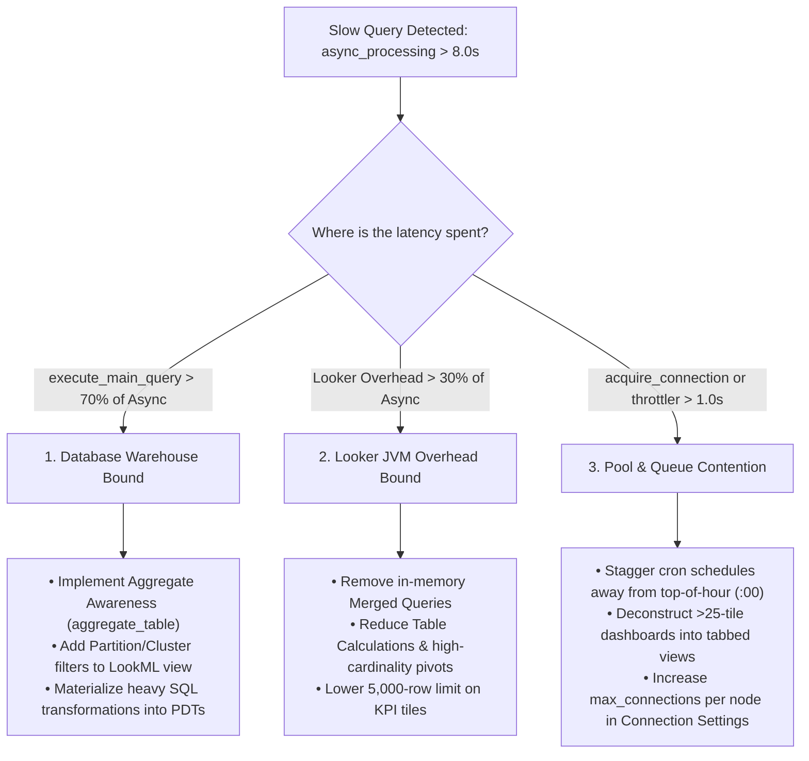

# Query Performance Audit & Forensic Triage Playbook

This reference document defines the complete diagnostic and remediation protocol for auditing query performance, query lifecycle latencies, connection contention, and Looker JVM internal overhead.

---

## 🔍 Part 1: How to Review & Diagnose Performance Bottlenecks

### 1. Progressive System Activity History Diagnostics (UI & Query Setup)

To identify slow queries using the **System Activity History Explore** (`system__activity/history`), you construct specific queries directly in the Looker UI or API. 

Because Looker's internal database logs every single query execution, you can isolate slowness step-by-step. Below is the precise guide on how to configure your System Activity History queries to analyze performance **per dashboard, per explore, per model**, and down to the **exact query definition**.

---

#### 📌 Key Takeaway
In Looker's System Activity, the dimension `Query` -> `View` represents the **Explore** name, and `Query` -> `Model` represents the **Model**. Always filter out irrelevant noise (like API queries or schedules) using the `History` -> `Source` dimension to ensure your diagnostic metrics are accurate.

---

#### Step 1: Per-Dashboard Diagnostics
This step helps you identify which specific dashboards are taking the longest to load and whether they are bottlenecked by live database calls or poor caching.

##### How to Build It in the History Explore:
1. **Add Dimensions**:
   * `Dashboard` ➡️ `Title` (`dashboard.title`)
   * `Dashboard` ➡️ `ID` (`dashboard.id`)
   * `History` ➡️ `Result Source` (`history.result_source`) — *Pivot this column* (this splits your runtime between live database runs (`query`) and cached runs (`cache`)).
2. **Add Measures**:
   * `History` ➡️ `Query Run Count` (`history.query_run_count`)
   * `History` ➡️ `Average Runtime in Seconds` (`history.average_runtime`)
3. **Add Filters**:
   * `History` ➡️ `Source` = `dashboard` (This excludes ad-hoc SQL runs, schedules, or API calls).
   * `History` ➡️ `Created Date` = `past 30 days` (Standard analysis window).
4. **Action**: Sort by `Average Runtime in Seconds` descending. 
   * *Analysis*: If a dashboard has a low runtime when cached, but an extremely high runtime under the `query` pivot, your database queries are slow. If it is slow even when cached, the dashboard has too many tiles, forcing too many concurrent layout redraws.

##### Inline System Activity Query:
```json
{
  "model": "system__activity",
  "view": "history",
  "fields": [
    "dashboard.id",
    "dashboard.title",
    "history.result_source",
    "history.query_run_count",
    "history.average_runtime"
  ],
  "pivots": ["history.result_source"],
  "filters": {
    "history.source": "dashboard",
    "history.created_date": "30 days"
  },
  "sorts": ["history.average_runtime desc 0"],
  "limit": "50"
}
```

---

#### Step 2: Per-Explore Diagnostics
This step isolates which Explore configurations are generating the heaviest, most intensive queries, regardless of who ran them or what dashboard they live on.

##### How to Build It in the History Explore:
1. **Add Dimensions**:
   * `Query` ➡️ `View` (`query.view`) — *This is the name of the Explore*.
   * `Query` ➡️ `Model` (`query.model`)
2. **Add Measures**:
   * `History` ➡️ `Query Run Count` (`history.query_run_count`)
   * `History` ➡️ `Average Runtime in Seconds` (`history.average_runtime`)
3. **Add Filters**:
   * `History` ➡️ `Created Date` = `past 30 days`.
   * `History` ➡️ `Status` = `complete` (This ignores queries that were cancelled or failed).
4. **Action**: Sort by `Average Runtime in Seconds` descending.
   * *Analysis*: Look for Explores with high runtimes. If an Explore has an average runtime > 10 seconds and a high run count, this indicates a missing database partition index, complex join structures, or a lack of pre-aggregation.

##### Inline System Activity Query:
```json
{
  "model": "system__activity",
  "view": "history",
  "fields": [
    "query.view",
    "query.model",
    "history.query_run_count",
    "history.average_runtime"
  ],
  "filters": {
    "history.created_date": "30 days",
    "history.status": "complete",
    "query.view": "-NULL"
  },
  "sorts": ["history.average_runtime desc"],
  "limit": "50"
}
```

---

#### Step 3: Per-Model Compilation Diagnostics
If a model has massive LookML files or too many nested files, users will experience a "hang" before the database query even starts. This is compile latency.

##### How to Build It in the History Explore:
1. **Add Dimensions**:
   * `Query` ➡️ `Model` (`query.model`)
2. **Add Measures**:
   * `History` ➡️ `Average Runtime in Seconds` (`history.average_runtime`)
   * `Query Metrics` ➡️ `Average Connection Wait Time` (If available on your Looker version — represents waiting for a connection slot).
   * `Query Metrics` ➡️ `Average Compilation Time` (Time spent by Looker generating the SQL text).
3. **Add Filters**:
   * `History` ➡️ `Created Date` = `past 30 days`.
4. **Action**: Sort by `Average Compilation Time` descending.
   * *Analysis*: If compilation time is > 2 seconds, your model is too bloated. You should consider splitting massive models into smaller, domain-specific models.

##### Inline System Activity Query:
```json
{
  "model": "system__activity",
  "view": "query_metrics",
  "fields": [
    "query.model",
    "history.average_runtime",
    "query_metrics.acquire_connection_average",
    "query_metrics.model_init_computed_average"
  ],
  "filters": {
    "history.created_date": "30 days",
    "query.model": "-NULL"
  },
  "sorts": ["query_metrics.model_init_computed_average desc"],
  "limit": "50"
}
```

---

#### Step 4: Drilling into the Specific "Slow Query"
Once you know which Explore is slow, you can find the exact query fields (dimensions/measures) and SQL causing the issue.

##### How to Build It in the History Explore:
1. **Add Dimensions**:
   * `Query` ➡️ `ID` (`query.id`) — *This represents the unique fingerprint of the fields chosen*.
   * `Query` ➡️ `View` (`query.view`)
   * `Query` ➡️ `Dynamic Fields` (`query.dynamic_fields`) — *Add this to see if users are running slow custom fields or table calculations*.
2. **Add Measures**:
   * `History` ➡️ `Query Run Count` (`history.query_run_count`)
   * `History` ➡️ `Average Runtime in Seconds` (`history.average_runtime`)
3. **Add Filters**:
   * `Query` ➡️ `View` = `your_slow_explore_name` (Identified in Step 2).
4. **Action**: Sort by `Average Runtime in Seconds` descending.
   * *Analysis*: Click on the highest `Query ID` to open the query in a new window. Go to the "SQL" tab of that query in Looker, or run it in SQL Runner to see the exact generated query layout and optimize your indexes accordingly.

##### Inline System Activity Query:
```json
{
  "model": "system__activity",
  "view": "history",
  "fields": [
    "query.id",
    "query.view",
    "query.dynamic_fields",
    "history.query_run_count",
    "history.average_runtime"
  ],
  "filters": {
    "query.view": "YOUR_SLOW_EXPLORE_NAME",
    "history.created_date": "30 days"
  },
  "sorts": ["history.average_runtime desc"],
  "limit": "25"
}
```

---

#### ⚠️ Common Pitfalls to Watch Out For
* **The "Created Date" Trap**: In System Activity, `query.created_date` refers to when that query signature was *first* run in the history of the instance, whereas `history.created_date` refers to when *this specific execution* ran. Always use `history.created_date` for operational analysis.
* **Including Failed Queries**: If you don't filter for `History` -> `Status` = `complete`, your average runtime might be artificially lowered by aborted or failed queries that finished in 0 seconds.

---

### 2. The 3-Way Forensic Triage Framework

When slow queries or long dashboard loading times are detected (`async_processing > 8.0s`), the consultant or agent classifies the root bottleneck into one of three distinct categories:



---

### 3. Diagnostic Telemetry Queries (System Activity)

#### A. Instance-Wide Performance KPI Scorecard
```json
{
  "model": "system__activity",
  "view": "query_metrics",
  "fields": [
    "query_metrics.async_processing_average",
    "query_metrics.execute_main_query_average",
    "query_metrics.acquire_connection_average",
    "query_metrics.project_init_average",
    "query_metrics.model_init_computed_average",
    "query_metrics.model_init_cache_average",
    "query_metrics.explore_init_average",
    "query_metrics.marshalled_cache_load_average",
    "query_metrics.prepare_average",
    "query_metrics.queued_average",
    "query_metrics.per_user_throttler_average",
    "query_metrics.stream_to_cache_average",
    "query_metrics.postprocessing_average",
    "history.query_run_count",
    "history.database_result_query_count"
  ],
  "filters": {
    "history.created_date": "30 days"
  },
  "limit": "1"
}
```

#### B. Identify Performance Bottlenecks by Explore
```json
{
  "model": "system__activity",
  "view": "query_metrics",
  "fields": [
    "query.model",
    "query.view",
    "history.query_run_count",
    "query_metrics.async_processing_average",
    "query_metrics.execute_main_query_average",
    "query_metrics.stream_to_cache_average"
  ],
  "filters": {
    "history.created_date": "30 days",
    "query.view": "-NULL"
  },
  "sorts": ["query_metrics.async_processing_average desc"],
  "limit": "15"
}
```

#### C. Top 20 Slowest Outlier Queries
```json
{
  "model": "system__activity",
  "view": "query_metrics",
  "fields": [
    "query.id",
    "user.name",
    "query.model",
    "query.view",
    "dashboard.title",
    "query_metrics.async_processing",
    "query_metrics.execute_main_query",
    "query_metrics.acquire_connection",
    "query_metrics.per_user_throttler",
    "query_metrics.stream_to_cache"
  ],
  "filters": {
    "history.created_date": "7 days"
  },
  "sorts": ["query_metrics.async_processing desc"],
  "limit": "20"
}
```

---

## 🛠️ Part 2: How to Rectify & Remediate Performance Bottlenecks

Now that you have gathered your latency data from the **System Activity History Explore**, you can transition from diagnosis to action. 

These results provide a clear roadmap of exactly where your technical debt lies. Below is the detailed, step-by-step remediation guide on what to do with the slow dashboards, explores, models, and query IDs you've isolated.

---

### 📌 Remediation Prioritization Matrix
Prioritize your efforts using a **high-volume, high-impact** matrix. Do not spend hours optimizing an Explore query that runs once a month. Focus first on the slowest **dashboards and queries** that have high run counts, as they are driving up your compute costs and causing the most user frustration.

---

### Phase 1: Actioning Slow Dashboard Results (Step 1 Results)
If your diagnostics show dashboards with high `Average Runtime` and high query run count:

* **Reduce Tile Density (Goal: < 25 tiles)**: Looker runs tiles concurrently. Having more than 20–25 tiles will saturate database connection pools and force queries into a "Queued" state. 
  * *Action*: Consolidate similar single-value KPI tiles. Instead of 10 individual metrics tiles, merge them into a single, clean table visualization.
* **Deploy Native Aggregate Awareness (Quickest Win)**:
  1. Go to the slow dashboard, click the three-dot actions menu (`...`), and select **"Get LookML"** ➡️ **"Aggregate Table LookML"**.
  2. Looker will automatically generate a custom `aggregate_table` LookML code block tailored exactly to that dashboard’s filters and tiles.
  3. Copy this LookML and paste it under the corresponding Explore definition.
  4. *Impact*: Instead of querying billions of rows of raw data, Looker will transparently redirect user requests to a pre-computed rollup table in your database, reducing dashboard load times from minutes to milliseconds.
* **Enforce Hard Date Filters**: Ensure every user-facing dashboard has a mandatory default date filter (e.g., "Past 30 days"). This prevents users from triggering massive, costly full-table scans.

---

### Phase 2: Actioning Slow Explore Results (Step 2 Results)
If your diagnostics show specific Explores are globally slow for ad-hoc users:

* **Audit Your Join Logic (Target: Many-to-One)**: 
  * *Action*: Review the Explore's join structure. Ensure you are joining tables from the most granular level to the highest level of detail (i.e., `relationship: many_to_one`). Avoid `one_to_many` or `many_to_many` joins as they force Looker to use expensive symmetric aggregates (`SUM_DISTINCT`), severely dragging down database performance.
* **Convert Complex Joins into Persistent Derived Tables (PDTs)**:
  * *Action*: If an Explore is slow because it performs many complicated joins or subqueries at runtime, convert those base joins into a PDT. This pre-joins the tables in your database ahead of time.
  * *Incremental PDTs*: If your database supports it (e.g., BigQuery, Snowflake), configure the PDT to build incrementally (`increment_key`) so it only compiles new daily data instead of rebuilding the entire history.
* **Align Caching Policies (`datagroups`)**: 
  * *Action*: If the average runtime is high, ensure the Explore is not hitting the database repeatedly for static data. Set up a `datagroup` in your LookML model using the `persist_with` parameter to synchronize Looker’s cache refresh perfectly with your database’s ETL refresh schedule.

---

### Phase 3: Actioning Slow Model Results (Step 3 Results)
If your diagnostics show high model compile/initialization times (`model_init_computed` or compilation latency is high):

* **Refactor Wildcard "Include" Statements**:
  * *Action*: Open your model files. If you see `include: "*.view"`, replace it. This wildcard forces Looker to compile every single view file in your project, even if they aren't used in that specific model. Be explicit (e.g., `include: "/views/sales_*.view"`).
* **Split Bloated Models**:
  * *Action*: If a single LookML model file contains 20+ Explores covering multiple business areas (Finance, HR, Logistics), split it into separate, domain-specific model files (e.g., `finance_analytics.model.lkml` and `hr_analytics.model.lkml`). This drastically speeds up compilation times.

---

### Phase 4: Actioning Specific Query IDs (Step 4 Results)
If you have drilled down to the exact `Query ID` that is causing database bottlenecks:

* **Run a Dry Run/EXPLAIN Plan**:
  * *Action*: Copy the Query ID's generated SQL, paste it into your database console (e.g., BigQuery, Snowflake, Redshift), and run an `EXPLAIN` or dry-run plan.
  * *Check Partitioning*: Ensure the dimensions being filtered on (such as dates or IDs) match the physical **partitioning and clustering keys** of your raw database tables.
* **Deconcatenate Primary Keys**:
  * *Action*: Look at your join keys. If tables are being joined on a concatenated primary key defined inside Looker (e.g., `CONCAT(store_id, product_id)`), this bypasses database indexes. Perform key concatenation inside your database ETL layer instead.
* **Migrate Frontend Logic to LookML**:
  * *Action*: If the Query ID's definition shows heavy use of dynamic custom fields or table calculations, migrate those calculations back into formal LookML dimensions/measures. Front-end calculations run on the user's browser, which causes severe browser-side rendering freezes.

---

### ⚠️ Common Remediation Pitfalls
* **Aggregate Tables Not Persisting**: Remember that aggregate tables are a type of PDT. For aggregate awareness to work, the database connection must have the scratch schema (`tmp` schema) enabled so Looker can write the pre-aggregated tables back to your database.
* **Redundant Dashboard Filters**: Watch out for dashboards with redundant filters that contradict each other. This creates conflicting query logic and completely bypasses any Looker caching.

---

### Master Remediation Playbook Reference Links:
* **Connection Pool & Queue Tuning**: [Remediation Protocol 1 in benchmarks.md](../references/benchmarks.md#remediation-protocol-1-connection-pool-starvation-acquire_connection--0238s)
* **Merged Query Elimination**: [merged_queries_remediation.md](../references/merged_queries_remediation.md)
* **Aggregate Table Code Generation**: [aggregate_awareness_and_architecture.md](../references/aggregate_awareness_and_architecture.md)
* **Dashboard Optimization Checklist**: [single_dashboard_optimization.md](../references/single_dashboard_optimization.md)
