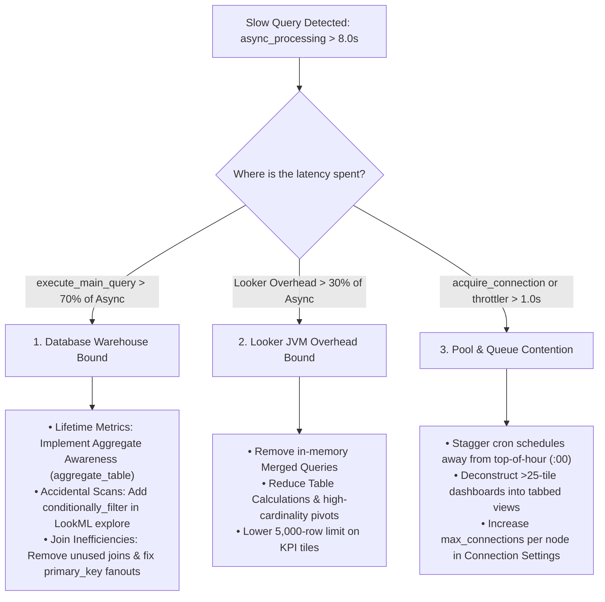

# Query Performance Audit & Forensic Triage Playbook

This reference document defines the complete diagnostic and remediation protocol for auditing query performance, query lifecycle latencies, connection contention, and Looker JVM internal overhead.

> [!NOTE]
> **Core Architecture & Playbook References**:
> * [`looker_bigquery_pipeline_architecture.md`](file:///Users/sampitcher/Documents/Projects/looker-healthcheck-agent/skills/custom/healthcheck/references/looker_bigquery_pipeline_architecture.md): The 6-Stage Interconnected Pipeline, 4 Major Failure Loops, and Dashboard Complexity Score.
> * [`looker-performance-optimizer`](file:///Users/sampitcher/Documents/Projects/looker-healthcheck-agent/skills/vendor/looker-skills/skills/looker-performance-optimizer/SKILL.md): Master Looker performance-by-design & active tuning engineering standards.
> * [`connecting-looker-to-bigquery`](file:///Users/sampitcher/Documents/Projects/looker-healthcheck-agent/skills/vendor/looker-skills/skills/connecting-looker-to-bigquery/SKILL.md): BigQuery connection tuning, partition pruning, and BI Engine acceleration.

---

## 🔍 Part 1: How to Review & Diagnose Performance Bottlenecks

### 1. Progressive System Activity History Diagnostics (Hierarchical Drilldown)

To isolate slow queries using the **System Activity History & Query Metrics Explores**, follow a top-down architectural hierarchy:

```
                          1. MODEL LEVEL DIAGNOSTICS
                     (Compile Latency, Model Scope Bloat)
                                     │
                                     ▼
                         2. EXPLORE LEVEL DIAGNOSTICS
                   (Heavy Explores, Unpartitioned Fact Scans)
                                     │
                                     ▼
                      3. DASHBOARD & USER DIAGNOSTICS
                 (Cache vs Query Pivots, Tile Bloat, Users)
                                     │
                                     ▼
                    4. SPECIFIC QUERY SIGNATURE & SQL
             (Query ID, Dynamic Fields, Table Calcs, SQL Runner)
```

---

#### 📌 Critical System Activity Dimension Rules (Must Follow):
1. **Model Dimension**: **ALWAYS** use `query.model` (e.g. `filters: {'query.model': 'thelook'}`). *Do NOT use `history.model_name` or `query_metrics.model` (they do not exist)*.
2. **Explore Dimension**: **ALWAYS** use `query.view` (e.g. `fields: ['query.view', 'query.model']`). *In System Activity, `query.view` represents the Explore name*.
3. **Execution Date**: **ALWAYS** use `history.created_date` (e.g. `filters: {'history.created_date': '30 days'}`). *`query.created_date` is the first time the query was ever defined and is misleading for operational health*.
4. **Status Filter**: Always filter `history.status = 'complete'` when measuring average runtimes so aborted or failed 0-second queries don't skew metrics.

---

#### Step 1: Per-Model Performance & Compilation Diagnostics
Evaluate performance at the macro model level to isolate models with excessive query runtimes or heavy compile latencies before queries even reach the database.

##### How to Build It in Query Metrics:
1. **Add Dimensions**: `Query` ➡️ `Model` (`query.model`).
2. **Add Measures**:
   * `History` ➡️ `Average Runtime in Seconds` (`history.average_runtime`)
   * `Query Metrics` ➡️ `Average Model Init (Computed)` (`query_metrics.model_init_computed_average`) — *Time spent compiling LookML into SQL*.
   * `Query Metrics` ➡️ `Average Connection Wait Time` (`query_metrics.acquire_connection_average`)
   * `History` ➡️ `Query Run Count` (`history.query_run_count`)
3. **Add Filters**:
   * `History` ➡️ `Created Date` = `past 30 days`.
   * `Query` ➡️ `Model` = `-NULL` (or filter by specific model e.g. `'thelook'`).
4. **Action**: Sort by `Average Model Init (Computed)` descending or `Average Runtime in Seconds` descending.
   * *Analysis*: If `model_init_computed > 2.42s`, the model is bloated with too many included files. Scope models into domain-specific `.model` files.

##### Inline System Activity Query:
```json
{
  "model": "system__activity",
  "view": "query_metrics",
  "fields": [
    "query.model",
    "history.query_run_count",
    "history.average_runtime",
    "query_metrics.acquire_connection_average",
    "query_metrics.model_init_computed_average"
  ],
  "filters": {
    "history.created_date": "30 days",
    "query.model": "-NULL"
  },
  "sorts": ["history.average_runtime desc"],
  "limit": "50"
}
```

---

#### Step 2: Per-Explore Diagnostics
Drill down into the target model to isolate which specific Explore configurations generate heavy, long-running queries.

##### How to Build It in History:
1. **Add Dimensions**:
   * `Query` ➡️ `View` (`query.view`) — *The Explore name*.
   * `Query` ➡️ `Model` (`query.model`)
2. **Add Measures**:
   * `History` ➡️ `Query Run Count` (`history.query_run_count`)
   * `History` ➡️ `Average Runtime in Seconds` (`history.average_runtime`)
3. **Add Filters**:
   * `Query` ➡️ `Model` = `your_model_name` (e.g. `'thelook'`).
   * `History` ➡️ `Created Date` = `past 30 days`.
   * `History` ➡️ `Status` = `complete`.
   * `Query` ➡️ `View` = `-NULL`.
4. **Action**: Sort by `Average Runtime in Seconds` descending.
   * *Analysis*: Explores with `average_runtime > 10.0s` indicate missing partition filters on fact tables, complex unindexed joins, or missing Aggregate Awareness rollups.

##### Inline System Activity Query:
```json
{
  "model": "system__activity",
  "view": "history",
  "fields": [
    "query.view",
    "query.model",
    "history.query_run_count",
    "history.average_runtime"
  ],
  "filters": {
    "query.model": "thelook",
    "history.created_date": "30 days",
    "history.status": "complete",
    "query.view": "-NULL"
  },
  "sorts": ["history.average_runtime desc"],
  "limit": "50"
}
```

---

#### Step 3: Per-Dashboard & User Diagnostics
Determine which dashboards and users are executing queries against the slow Explores, and isolate whether slowness is database-bound or caused by un-cached dashboard layout / tile bloat.

##### How to Build It in History:
1. **Add Dimensions**:
   * `Dashboard` ➡️ `Title` (`dashboard.title`)
   * `Dashboard` ➡️ `ID` (`dashboard.id`)
   * `User` ➡️ `Name` (`user.name`)
   * `History` ➡️ `Result Source` (`history.result_source`) — *Pivot this column* (splits runtime between live database runs `query` and cached runs `cache`).
2. **Add Measures**:
   * `History` ➡️ `Query Run Count` (`history.query_run_count`)
   * `History` ➡️ `Average Runtime in Seconds` (`history.average_runtime`)
3. **Add Filters**:
   * `Query` ➡️ `Model` = `your_model_name` (optional).
   * `History` ➡️ `Source` = `dashboard`.
   * `History` ➡️ `Created Date` = `past 30 days`.
4. **Action**: Sort by `Average Runtime in Seconds` descending.
   * *Analysis*:
     - **Slow under `result_source: query`**: Database execution bottleneck $\rightarrow$ apply warehouse partition filters or caching datagroups.
     - **Slow even under `result_source: cache`**: Dashboard has **tile bloat (>25 tiles)** forcing browser layout thread contention.

##### Inline System Activity Query:
```json
{
  "model": "system__activity",
  "view": "history",
  "fields": [
    "dashboard.id",
    "dashboard.title",
    "user.name",
    "history.result_source",
    "history.query_run_count",
    "history.average_runtime"
  ],
  "pivots": ["history.result_source"],
  "filters": {
    "history.source": "dashboard",
    "history.created_date": "30 days"
  },
  "sorts": ["history.average_runtime desc 0"],
  "limit": "50"
}
```

---

#### Step 4: Drilling into the Specific "Slow Query" & Autonomous SQL/LookML Diagnosis
Once you isolate the slow Explore (e.g. `flights`), find the exact query signatures and **autonomously inspect their generated SQL and LookML definitions** (do not ask the user to manually click around Looker Admin).

##### How to Build It in History:
1. **Add Dimensions**:
   * `Query` ➡️ `ID` (`query.id`) — *Unique query signature fingerprint*.
   * `Query` ➡️ `View` (`query.view`)
   * `Query` ➡️ `Dynamic Fields` (`query.dynamic_fields`) — *Detects custom table calculations*.
   * `History` ➡️ `Slug` (`history.slug`) — *Direct Looker URL share link*.
2. **Add Measures**:
   * `History` ➡️ `Query Run Count` (`history.query_run_count`)
   * `History` ➡️ `Average Runtime in Seconds` (`history.average_runtime`)
3. **Add Filters**:
   * `Query` ➡️ `Model` = `your_model_name` (e.g. `'thelook'`).
   * `Query` ➡️ `View` = `your_slow_explore_name` (e.g. `'flights'`).
   * `History` ➡️ `Created Date` = `past 30 days`.
4. **Action**: Sort by `Average Runtime in Seconds` descending.

##### Inline System Activity Query:
```json
{
  "model": "system__activity",
  "view": "history",
  "fields": [
    "query.id",
    "query.view",
    "query.model",
    "query.dynamic_fields",
    "history.slug",
    "history.query_run_count",
    "history.average_runtime"
  ],
  "filters": {
    "query.model": "thelook",
    "query.view": "YOUR_SLOW_EXPLORE_NAME",
    "history.created_date": "30 days",
    "history.status": "complete"
  },
  "sorts": ["history.average_runtime desc"],
  "limit": "10"
}
```

##### 🤖 Autonomous Agent Forensic Next Steps (MANDATORY — 5-Vector Analysis):
When you identify the top slow Query IDs from the query above, **never assume adding a filter is the only solution**. A slow query measuring lifetime user metrics or all-time totals legitimately needs full-history data. Evaluate all **5 Root Cause Vectors**:
1. **Vector 1 (Phase Breakdown)**: Query `system__activity/query_metrics` for that `query.id` to verify if latency was physical database execution (`execute_main_query`), connection pool wait (`acquire_connection`), or network streaming (`stream_to_cache`).
2. **Vector 2 (SQL & Join Inefficiencies)**: Call `get_query_sql(query_id)`. Look for redundant `LEFT JOIN`s where no columns from the joined table are in `SELECT`, or `SUM(DISTINCT ...)` symmetric aggregation overhead caused by missing `primary_key: yes` or bad `relationship:` parameters.
3. **Vector 3 (Aggregate Acceleration)**: If the query is an intentional full-table scan for lifetime/cohort metrics, prescribe **LookML Aggregate Awareness (`aggregate_table:`)** or an **Incremental PDT** to pre-aggregate the data instead of breaking business logic with date filters.
4. **Vector 4 (Warehouse Slot Contention)**: Run `run_bq_query` with `INFORMATION_SCHEMA.JOBS_TIMELINE_BY_PROJECT` (from `warehouse_optimization.md`) to check if BigQuery slots were saturated at that exact execution timestamp.
5. **Vector 5 (Colocated Query Bursts)**: Query `system__activity/history` for all queries executed at the same timestamp (`history.created_time`) to see if a 25-tile dashboard or cron burst saturated the instance.

---

### 2. The 3-Way Forensic Triage Framework & 5 Root Cause Vectors

When slow queries or long dashboard loading times are detected (`async_processing > 8.0s`), classify the root bottleneck into one of three distinct categories:



> [!TIP]
> **Deep-Dive Outlier Protocol**: For the full 18-phase query lifecycle decomposition, individual outlier extraction queries, 5-vector forensic breakdown, and standardized stakeholder reporting scorecard templates, consult **[`query_outliers_diagnosis.md`](../references/query_outliers_diagnosis.md)**.

---

### 3. Diagnostic Telemetry Queries (System Activity)

#### A. Instance-Wide Performance KPI Scorecard
```json
{
  "model": "system__activity",
  "view": "query_metrics",
  "fields": [
    "query_metrics.async_processing_average",
    "query_metrics.execute_main_query_average",
    "query_metrics.acquire_connection_average",
    "query_metrics.project_init_average",
    "query_metrics.model_init_computed_average",
    "query_metrics.model_init_cache_average",
    "query_metrics.explore_init_average",
    "query_metrics.marshalled_cache_load_average",
    "query_metrics.prepare_average",
    "query_metrics.queued_average",
    "query_metrics.per_user_throttler_average",
    "query_metrics.stream_to_cache_average",
    "query_metrics.postprocessing_average",
    "history.query_run_count",
    "history.database_result_query_count"
  ],
  "filters": {
    "history.created_date": "30 days"
  },
  "limit": "1"
}
```

#### B. Identify Performance Bottlenecks by Explore
```json
{
  "model": "system__activity",
  "view": "query_metrics",
  "fields": [
    "query.model",
    "query.view",
    "history.query_run_count",
    "query_metrics.async_processing_average",
    "query_metrics.execute_main_query_average",
    "query_metrics.stream_to_cache_average"
  ],
  "filters": {
    "history.created_date": "30 days",
    "query.view": "-NULL"
  },
  "sorts": ["query_metrics.async_processing_average desc"],
  "limit": "15"
}
```

#### C. Top Slowest Outlier Queries by Database Execution Time (Warehouse-Bound / Pillar 3)
```json
{
  "model": "system__activity",
  "view": "query_metrics",
  "fields": [
    "query.id",
    "user.name",
    "query.model",
    "query.view",
    "dashboard.title",
    "query_metrics.async_processing",
    "query_metrics.execute_main_query",
    "query_metrics.acquire_connection",
    "query_metrics.postprocessing",
    "history.created_time"
  ],
  "filters": {
    "history.created_date": "7 days",
    "history.status": "complete"
  },
  "sorts": ["query_metrics.execute_main_query desc"],
  "limit": "10"
}
```
