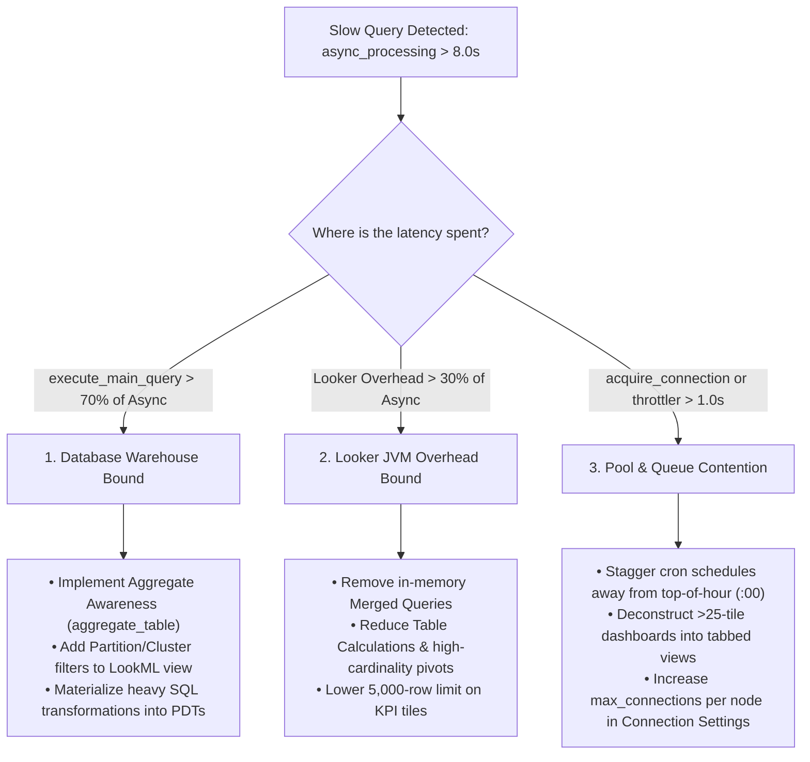

# Query Performance Audit & Forensic Triage Playbook

This reference document defines the complete diagnostic and remediation protocol for auditing query performance, query lifecycle latencies, connection contention, and Looker JVM internal overhead.

---

## 🔍 Part 1: How to Review & Diagnose Performance Bottlenecks

### 1. The 3-Way Forensic Triage Framework

When slow queries or long dashboard loading times are detected (`async_processing > 8.0s`), the consultant or agent classifies the root bottleneck into one of three distinct categories:



---

### 2. Diagnostic Telemetry Queries (System Activity)

#### A. Instance-Wide Performance KPI Scorecard
```json
{
  "model": "system__activity",
  "view": "query_metrics",
  "fields": [
    "query_metrics.async_processing_average",
    "query_metrics.execute_main_query_average",
    "query_metrics.acquire_connection_average",
    "query_metrics.project_init_average",
    "query_metrics.model_init_computed_average",
    "query_metrics.model_init_cache_average",
    "query_metrics.explore_init_average",
    "query_metrics.marshalled_cache_load_average",
    "query_metrics.prepare_average",
    "query_metrics.queued_average",
    "query_metrics.per_user_throttler_average",
    "query_metrics.stream_to_cache_average",
    "query_metrics.postprocessing_average",
    "history.query_run_count",
    "history.database_result_query_count"
  ],
  "filters": {
    "history.created_date": "30 days"
  },
  "limit": "1"
}
```

#### B. Identify Performance Bottlenecks by Explore
```json
{
  "model": "system__activity",
  "view": "query_metrics",
  "fields": [
    "query.model",
    "query.view",
    "history.query_run_count",
    "query_metrics.async_processing_average",
    "query_metrics.execute_main_query_average",
    "query_metrics.stream_to_cache_average"
  ],
  "filters": {
    "history.created_date": "30 days",
    "query.view": "-NULL"
  },
  "sorts": ["query_metrics.async_processing_average desc"],
  "limit": "15"
}
```

#### C. Top 20 Slowest Outlier Queries
```json
{
  "model": "system__activity",
  "view": "query_metrics",
  "fields": [
    "query.id",
    "user.name",
    "query.model",
    "query.view",
    "dashboard.title",
    "query_metrics.async_processing",
    "query_metrics.execute_main_query",
    "query_metrics.acquire_connection",
    "query_metrics.per_user_throttler",
    "query_metrics.stream_to_cache"
  ],
  "filters": {
    "history.created_date": "7 days"
  },
  "sorts": ["query_metrics.async_processing desc"],
  "limit": "20"
}
```

---

## 🛠️ Part 2: How to Rectify & Remediate Bottlenecks

### Remediation A: Fixing Connection Pool & Queue Contention (`acquire_connection > 0.5s`)
1. **Increase Connection Pool Limits**:
   * Navigate to **Admin** $\rightarrow$ **Connections** $\rightarrow$ **Edit**.
   * Increase `Max Connections per Node` from 30 to `40–60` (verify database instance supports elevated connections).
2. **Stagger Scheduled Reports**:
   * Inspect all automated delivery crons running at `:00` and redistribute across `:07`, `:22`, `:37`, `:52`.
3. **Deconstruct Bloated Dashboards**:
   * Split dashboards containing $>25$ query tiles into separate tabs or linked summary dashboards.

---

### Remediation B: Fixing High Looker Overhead (`Looker Overhead > 20%`)
1. **Eliminate Merged Queries**:
   * Replace in-memory merged query tiles with native LookML explores joined on primary/foreign keys.
2. **Migrate Frontend Calculations Upstream**:
   * Re-implement expensive table calculations (e.g. running totals, complex string regexes) directly in LookML view dimensions or database SQL.
3. **Clamp Row Limits**:
   * Ensure single-value KPI cards use `limit: 1` rather than the default `limit: 5000`.

---

### Remediation C: Fixing Database Warehouse Latency (`execute_main_query > 5.0s`)
1. **Implement Aggregate Awareness**:
   * Add `aggregate_table:` rollups to high-traffic explores to serve summary queries from pre-aggregated compact tables.
2. **Enforce Partition and Cluster Filters**:
   * Add `conditionally_filter` or `require_partition_filter: yes` to explore definitions on partition date dimensions:
   ```lookml
   explore: orders {
     conditionally_filter: {
       filters: [orders.created_date: "past 30 days"]
       unless: [orders.id]
     }
   }
   ```
3. **Materialize Heavy Derived Tables into PDTs**:
   * Convert dynamic `derived_table: { sql: ... }` views into Persistent Derived Tables with datagroup triggers.
