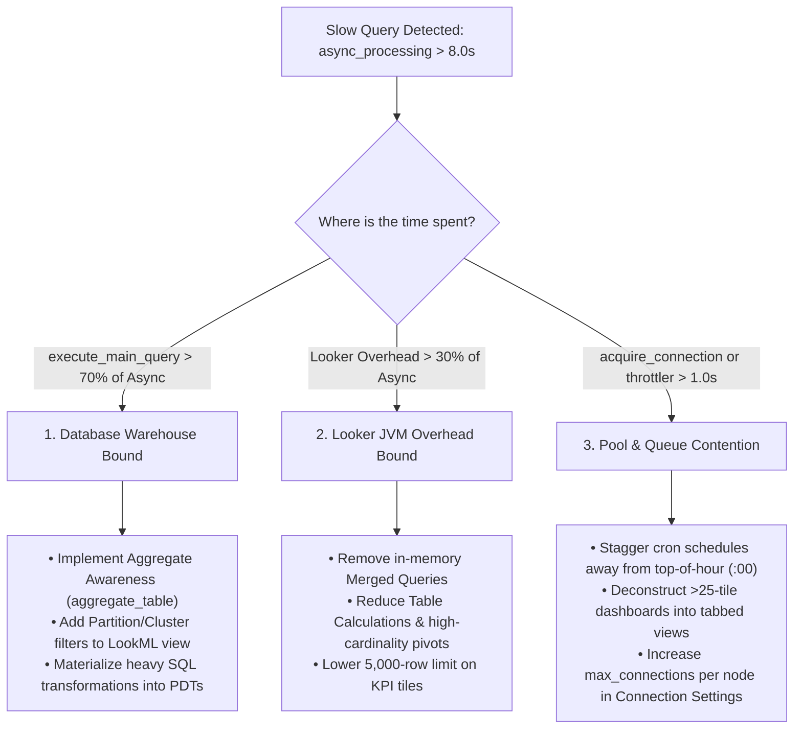

# Recipe 02: Performance Audit Review & Query Lifecycle (Component 2)

## 1. Objective & Purpose
Execute a forensic diagnostic audit of query lifecycle latencies, database warehouse execution times, concurrency bottlenecks, and Looker internal overhead across the entire query lifecycle.

```
                           THE LOOKER QUERY LIFECYCLE
 ┌─────────────────────────────────────────────────────────────────────────────────────────────┐
 │ 1. INITIALIZATION PHASE: LookML Compilation & Schema Resolution                             │
 │    • project_init ──> model_init_cache / computed ──> explore_init ──> prepare (SQL gen)   │
 ├─────────────────────────────────────────────────────────────────────────────────────────────┤
 │ 2. EXECUTION PHASE: Concurrency, Connection Acquisition & Warehouse Run                     │
 │    • per_user_throttler ──> queued ──> acquire_connection ──> execute_main_query           │
 ├─────────────────────────────────────────────────────────────────────────────────────────────┤
 │ 3. POST-PROCESSING PHASE: Stream, Format, In-Memory Calculations & Totals                   │
 │    • execute_totals_query ──> stream_to_cache ──> load_process_and_stream / in_memory      │
 └─────────────────────────────────────────────────────────────────────────────────────────────┘
```

---

## 2. Master Performance SLA & Benchmark Thresholds

| Lifecycle Metric | Metric Name | Target Benchmark | Warning Threshold | Critical Threshold | Root Cause / Impact |
| :--- | :--- | :---: | :---: | :---: | :--- |
| **Total Async Time** | `async_processing_average` | **`< 5.00s`** | `> 8.00s` | `> 15.00s` | Overall user-perceived query runtime. |
| **Warehouse Execution** | `execute_main_query_average` | **`< 4.00s`** | `> 7.00s` | `> 12.00s` | Database warehouse SQL performance. |
| **Connection Pool** | `acquire_connection_average` | **`< 0.25s`** | `> 0.50s` | `> 1.50s` | Pool starvation; max connections exceeded. |
| **Looker Worker Queue**| `queued_average` | **`0.00s`** | `> 0.10s` | `> 0.50s` | All worker threads busy executing queries. |
| **User Throttling** | `per_user_throttler_average` | **`0.00s`** | `> 0.10s` | `> 1.00s` | Single user exceeding 15 queries/node limit. |
| **SQL Generation** | `prepare_average` | **`< 0.20s`** | `> 0.45s` | `> 1.00s` | Complex Liquid logic, huge explore joins. |
| **Project Schema** | `project_init_average` | **`< 0.10s`** | `> 0.25s` | `> 0.50s` | Monolithic project with too many view files. |
| **Model Compilation** | `model_init_computed_average`| **`< 2.00s`** | `> 2.50s` | `> 5.00s` | Model contains too many explores. |
| **Stream to Cache** | `stream_to_cache_average` | **`< 0.25s`** | `> 0.50s` | `> 1.50s` | Excessive table calculations or row bloat. |
| **Looker Overhead %**| `((Async - (Main+Conn)) / Async)`| **`< 20.0%`** | `> 30.0%` | `> 50.0%` | Looker JVM spending time in formatting/RAM. |
| **Cache Hit Ratio** | `1 - (DB Queries / Total Runs)`| **`> 50.0%`** | `< 40.0%` | `< 25.0%` | Misaligned datagroups or arbitrary `persist_for`. |

---

## 3. Diagnostic Execution Protocols (System Activity Queries)

### A. Instance-Wide Lifecycle KPI Scorecard
```json
{
  "model": "system__activity",
  "view": "query_metrics",
  "fields": [
    "query_metrics.async_processing_average",
    "query_metrics.execute_main_query_average",
    "query_metrics.acquire_connection_average",
    "query_metrics.project_init_average",
    "query_metrics.model_init_computed_average",
    "query_metrics.model_init_cache_average",
    "query_metrics.explore_init_average",
    "query_metrics.marshalled_cache_load_average",
    "query_metrics.prepare_average",
    "query_metrics.queued_average",
    "query_metrics.per_user_throttler_average",
    "query_metrics.stream_to_cache_average",
    "query_metrics.postprocessing_average",
    "history.query_run_count",
    "history.database_result_query_count"
  ],
  "filters": {
    "history.created_date": "30 days"
  },
  "limit": "1"
}
```

### B. Identify Bottlenecks by Explore
```json
{
  "model": "system__activity",
  "view": "query_metrics",
  "fields": [
    "query.model",
    "query.view",
    "history.query_run_count",
    "query_metrics.async_processing_average",
    "query_metrics.execute_main_query_average",
    "query_metrics.stream_to_cache_average"
  ],
  "filters": {
    "history.created_date": "30 days",
    "query.view": "-NULL"
  },
  "sorts": ["query_metrics.async_processing_average desc"],
  "limit": "15"
}
```

### C. Top 20 Slowest Outlier Queries
```json
{
  "model": "system__activity",
  "view": "query_metrics",
  "fields": [
    "query.id",
    "user.name",
    "query.model",
    "query.view",
    "dashboard.title",
    "query_metrics.async_processing",
    "query_metrics.execute_main_query",
    "query_metrics.acquire_connection",
    "query_metrics.per_user_throttler",
    "query_metrics.stream_to_cache"
  ],
  "filters": {
    "history.created_date": "7 days"
  },
  "sorts": ["query_metrics.async_processing desc"],
  "limit": "20"
}
```

---

## 4. The 3-Way Forensic Triage Decision Tree

When diagnosing slow queries (`async_processing > 8.0s`), determine which category the latency falls into:



---

## 5. Remediation Recipes

### Remediation A: Fixing Connection Pool Starvation (`acquire_connection > 0.5s`)
1. Open Looker Admin $\rightarrow$ **Connections** $\rightarrow$ Edit Connection.
2. Check `Max Connections per Node`. The default is often set to 30. If your warehouse supports higher concurrency, increase to `40–60`.
3. Stagger scheduled deliveries: Check all schedules firing on `:00` and redistribute across `:07`, `:22`, `:37`, `:52`.

### Remediation B: Fixing High Looker Overhead (`Overhead > 30%`)
1. Inspect the dashboard for **Merged Queries**. Migrate merged tiles into native LookML explores with proper `join:` relationships.
2. Remove expensive frontend Table Calculations (e.g. `running_total`, complex string regex) and compute them directly in warehouse SQL or derived tables.
3. Reduce row limits: Single-value KPI cards should have `limit: 1`, not `limit: 5000`.
